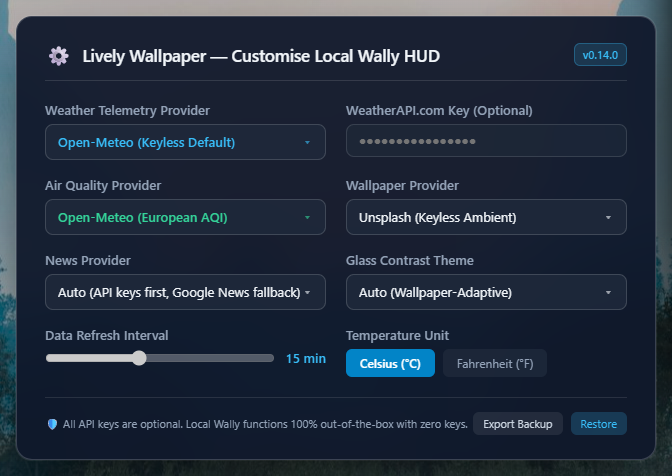
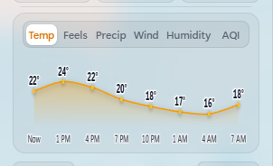
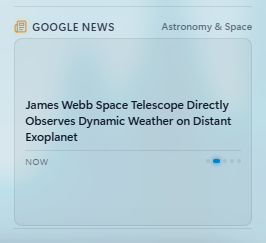
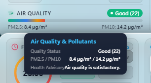
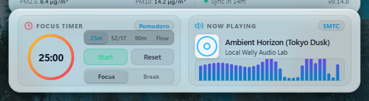

# Local Wally HUD

[](LICENSE)
[](#)
[](#)
[](#)

> **A beautiful, lightweight live weather wallpaper and smart desktop dashboard for Windows 11 & Lively Wallpaper.**

Local Wally HUD turns your Windows 11 desktop into an ambient, living dashboard. It brings together live local weather, interactive 24-hour forecast charts, air quality metrics, real-time music controls with a live audio visualizer, a Pomodoro focus timer, PC hardware monitoring, and regional news headlines—all set against dynamic landscape photography that naturally changes lighting from sunrise to night.

Best of all, it is designed from the ground up to be **invisible to your computer's performance**: it parks to roughly **0% CPU when idle on the author's target hardware** (Ryzen AI / WebView2 — measured informally, not a cross-hardware guarantee), keeps battery impact low in practice, and requires **no account or API keys** to work out of the box.

<p align="center">
  
</p>

---

## ✨ Why Local Wally?

Most animated wallpapers are notorious resource hogs. They run heavy video loops or unoptimized browser scripts that constantly eat 5–15% of your CPU, drain your laptop battery, and cause micro-stutter when gaming.

**Local Wally was engineered differently:**

1. **Ultra-Low Battery & CPU Usage**: Uses smart memory management and recycling buffers so it never causes background lag or stutter.
2. **Automatically Sleeps When Busy**: The moment you maximize a window, launch a game, or lock your screen, Lively Wallpaper puts Local Wally into deep sleep—dropping CPU and GPU usage to **0%**.
3. **Desktop-Friendly Layout**: Sits neatly on the right half of your screen so all your regular Windows desktop icons on the left stay 100% visible and uncluttered.
4. **Zero Setup Needed**: Works the second you install it. It finds your local weather and sunrise/sunset times automatically without requiring API keys, accounts, or credit cards.

---

## 🚀 Key Features

### 🎵 Music Player & 60 FPS Sound Visualizer
- **Works with Your Favorite Music Apps**: Shows the current song title, artist, and album artwork from Spotify, YouTube Music, Apple Music, Amazon Music, or any web browser playing audio.
- **Smooth 32-Bar Sound Spectrum**: Features a fluid, 60 FPS sound wave visualizer that dances to your music in real time.
- **Smart Silence Sleeping**: When music stops or is paused for more than 1.5 seconds, the visualizer automatically goes to sleep and clears the canvas — animation work drops to idle (≈0% CPU on the author's target hardware; not a guarantee on other systems).
- **Interactive Preview Mode**: Test it anytime in your browser by pressing <kbd>M</kbd> to cycle through built-in demo tracks (Synthwave, Lo-Fi, Ambient).

### ⏱️ Pomodoro Focus & Break Timer
- **Built-in Desktop Productivity**: Stay productive with a clean circular countdown timer right on your desktop.
- **One-Click Controls**: Click Start/Pause (or press <kbd>P</kbd>), Reset, or switch between 25-minute Focus sessions, 5-minute Short Breaks, and 15-minute Long Breaks.
- **Precise & Battery-Safe**: Uses real wall-clock timestamps so it never loses time or drifts, even if your PC is under heavy load. If you open a full-screen app, the timer pauses background animations and picks right back up when you return.

### ☀️ Realistic Day, Night & Solar Lighting
- **Multi-Source Living Landscapes**: Choose between Unsplash (keyless default), Wallhaven, Pexels, Pixabay, or automatic round-robin source rotation. High-resolution landscape photography matches your screen resolution and updates with live weather conditions, overlaid with real-time solar lighting:
  - **Sunrise & Sunset**: Warm amber and rose horizon glows.
  - **Golden Hour**: Radiant warm sunlight wash across the landscape.
  - **Midday**: Crisp daylight glow with realistic directional sunlight flares.
  - **Night**: Soft moonlit luminescence and clear, illuminated night wallpaper with gentle nocturnal ambiance.
- **Real-Time Moving Shadows**: The dashboard cards cast subtle drop shadows that shift angle and depth as the sun moves across your sky throughout the day.
- **Instant Boot (No Blank Screens)**: Remembers your last wallpaper so your desktop looks gorgeous the millisecond your PC boots up, with zero blank white flashes.

### 🪟 Smart Glass Contrast (Always Readable)
- Wallpapers change from snowy mountains to dark night forests—and your text should always stay readable.
- Local Wally automatically reads the brightness of the photo behind the dashboard:
  - On **bright wallpapers**, it smoothly shifts to a high-contrast **Light Glass Theme** with dark slate text.
  - On **dark wallpapers**, it uses a sleek **Dark Glass Theme** with crisp white text.
- This check happens only once when a wallpaper loads, ensuring zero performance impact while you work.

### ⚡ Smart Hardware Protection (Laptops vs. Gaming PCs)
- **Automatic Graphics Detection**: Identifies whether your computer is running on an integrated laptop chip (like Intel Iris/Arc or AMD Radeon graphics) or a dedicated gaming graphics card (like NVIDIA GeForce RTX).
- **Battery Saver for Laptops**: Automatically uses efficient 1:1 pixel rendering on laptops to stay cool and save battery.
- **Crisp Quality on Gaming PCs**: Delivers enhanced supersampling on powerful desktop graphics cards for razor-sharp glass borders and icons.

### 📐 1:1 Sharp Resolution Matching
- Automatically detects your exact monitor resolution (1080p, 1440p, 4K, or ultrawide) and downloads wallpaper photos tailored to your exact screen dimensions. This ensures crystal-clear backgrounds without blurry scaling or wasted graphics memory.

### 🌦️ Live Local Weather & Air Quality
- **Accurate Multi-Source Weather**: Choose between three free global weather providers:
  - **Open-Meteo** (Default): Keyless, high-precision global weather models.
  - **MET Norway / Yr.no**: European meteorological service (client-side queries route reliably via Open-Meteo).
  - **OpenWeatherMap**: Keyed integration with automatic free fallbacks.
- **Air Quality Monitoring**: Real-time European Air Quality Index (AQI) with pollutant levels (PM2.5 / PM10) via Open-Meteo or WAQI ground stations.
- **Atmospheric Wind Streamlines**: Dynamic, Windy.com-inspired particle streamlines drifting behind the temperature display, animated along the live meteorological wind bearing with speed and gust surges, designed for 60 FPS zero-GC rendering and 0% CPU calm/parked states.
- **3-Tier Cloud Layer Telemetry**: Dedicated cloud metric card with animated High (>6km), Mid (2–6km), and Low (<2km) cloud strata, featuring dominant layer callouts (e.g. `High 99%`, `Mid 65%`, `Low 45%`, `Clear 0%`) and comprehensive telemetry breakdowns in progressive disclosure popovers and detail drawers.
- **Dynamic Day & Night Ephemeris Cards**: Replaced static solar/lunar rows with three glanceable, context-adaptive cards automatically determined by physical astronomical solar altitude (`altitude > -0.01454` radians):
  - **Daytime**: (1) **Rain Outlook** (imminent precipitation window & peak probability or clear-sky status), (2) **Feels-Like Peak** (daily maximum apparent temperature & time), (3) **Daylight Left** (remaining hours to sunset or active golden hour countdown).
  - **Nighttime**: (1) **Next Golden Hour** (morning window start/end and countdown), (2) **Moon Phase & Visibility Outlook** (astronomical emoji glyph, illumination %, waxing/waning status, horizon altitude, and forecast cloud factor), (3) **Next Sky Event** (dawn, sunrise, moonset, or NASA 2026 meteor shower/solstice calendar).
- **Zero-Config Location**: Automatically finds your city via Windows location or secure IP lookup, with safe offline defaults if internet access is interrupted.

### 🔍 Progressive Disclosure Hover Popovers & Accessibility
- **Floating Acrylic Hover Cards**: Hovering or focusing any of the 22 HUD and companion dock elements displays a floating glass popover (`#hud-hover-popover`) with 12px blur, progressive disclosure telemetry, and viewport boundary clamping (prevents edge clipping).
- **Full Keyboard & Touch Accessibility**: Focus seamlessly via <kbd>Tab</kbd> with dynamic `aria-describedby` binding, or dismiss instantly with <kbd>Esc</kbd>. Zero network requests on hover.

### 📊 Space-Efficient 24-Hour Forecast Chart
- **Compact & Glare-Free**: An inline vector weather chart that shows you exactly what to expect over the next 24 hours without cluttering your desktop.
- **6 Switchable Forecast Tabs**:
  - 🌡️ **Temp**: Temperature curve with clear hourly highs and lows.
  - 🔥 **Feels**: "Feels like" apparent temperature.
  - 🌧️ **Precip**: Rain and precipitation probability (0–100%).
  - 💨 **Wind**: Wind speed trajectory in km/h or mph.
  - 💧 **Humidity**: Relative humidity percentage.
  - 🍃 **AQI**: Color-coded air quality index trajectory.
- **Easy to Read & Navigate**: Bold labels with high-contrast outlines for easy scanning at any distance. Navigate tabs with your mouse or keyboard arrow keys (<kbd>←</kbd> / <kbd>→</kbd>).

### 💻 Computer Hardware Monitor & Sparklines
- **Live System Health**: Clean live graphs showing CPU usage, GPU 3D engine load, RAM memory usage, Disk storage, and Network Download & Upload speeds.
- **Smooth Mini Graphs (Sparklines)**: Real-time 40-point history graphs that update smoothly with zero noticeable CPU usage.
- **Smart Laptop Battery Meter**: Shows battery percentage and charging state (⚡). Automatically hides itself on desktop PCs so no space is wasted.

### 📰 Multi-Source Regional News & Interactive Dots
- **Flexible News Providers**: Choose between Google News (GDELT DOC 2.0 keyless default & fallback), NewsAPI, Currents News, or automatic rotation across configured sources.
- **15-Minute Cache Firewall**: Prevents rate-limit exhaustion and battery drain with strict client-side caching and in-flight de-duplication across reloads and UI interactions.
- **Dynamic Source Labeling**: Header and accessibility tags dynamically update to reflect the active provider (`Google News`, `NewsAPI`, `Currents News`).
- **Interactive Story Dots**: Hovering any dot reveals the publisher outlet and publish age in the floating popover; clicking or keyboard-activating (<kbd>Enter</kbd> / <kbd>Space</kbd>) instantly switches stories and resets the rotation timer. Direct safe `https:` outbound links to full publisher articles in your browser.

---

## 🧭 Interactive HUD Controls and Setup Walkthrough

Local Wally HUD provides a responsive, zero-configuration interface on your desktop. Here is how each major control and configuration surface works.

### 1. First Launch and Location Detection

When Local Wally starts for the first time, it automatically identifies your city using Windows location services or secure IP geolocation.
- **Silent Boot**: Weather and astronomical ephemeris load automatically for your area without prompts or configuration dialogs.
- **Offline Resilience**: If your internet connection is unavailable or interrupted, Local Wally falls back to cached values or a safe default without crashing or showing broken state.
- **Manual Location Override**: If you prefer a fixed city or travel frequently, press <kbd>D</kbd> on your desktop to open the Diagnostics panel and enter your preferred coordinates or city name. You can return to automatic location at any time by clicking **Use automatic**.

---

### 2. Customizing Weather, Air Quality, and Wallpaper Providers

Right-click Local Wally in your Lively Wallpaper library and select **Customise Wallpaper** to access all provider options:

<p align="center">
  
</p>

- **Weather Telemetry Provider**:
  - **Open-Meteo (Keyless Default)**: High-resolution global forecast models with zero configuration.
  - **WeatherAPI.com (Free Key)**: Alternate global provider with comprehensive current conditions and hourly projections. Enter your free key in the **WeatherAPI.com API Key** field.
  - **OpenWeatherMap (Key Optional)**: Keyed integration for users with existing OpenWeatherMap accounts.
- **Air Quality Provider**: Choose between Open-Meteo (European AQI standard) or WAQI ground monitoring stations.
- **Wallpaper Providers and Rotation**: Choose from Unsplash (keyless ambient default), Wallhaven, Pexels, Pixabay, or automatic round-robin rotation across providers.
- **Credential Safety**: All API key input fields in Lively Wallpaper and settings dialogs are masked or optional. Local Wally functions completely out of the box with zero keys.

---

### 3. Interactive 24-Hour Forecast Chart

The weather forecast card includes an inline SVG chart displaying Catmull-Rom Bezier curves for the upcoming 24 hours:

<p align="center">
  
</p>

- **Metric Tabs**: Click any of the six metric tabs (or use the <kbd>←</kbd> and <kbd>→</kbd> arrow keys when focused) to switch between:
  - **Temp**: Hourly temperature in Celsius or Fahrenheit.
  - **Feels**: Apparent temperature accounting for wind chill and humidity.
  - **Precip**: Rain and precipitation probabilities (0% to 100%).
  - **Wind**: Surface wind speed trajectories.
  - **Humidity**: Relative atmospheric humidity levels.
  - **AQI**: Color-coded European Air Quality Index trajectory.
- **Point Tooltips**: Hover your cursor over any hourly marker or label to view an instant readout of exact projected values.

---

### 4. Regional News Navigation and Story Indicators

The regional news dispatch keeps you informed with local and global headlines:

<p align="center">
  
</p>

- **Story Indicators**: The bottom-right corner of the news card features interactive pagination dots. An elongated cyan pill marks the active story.
- **Hover Previews**: Hover your mouse over any dot to see the publisher name and relative publish time in a floating acrylic tooltip.
- **Manual Story Selection**: Click any dot or press <kbd>Enter</kbd> or <kbd>Space</kbd> when navigating via keyboard to jump directly to that story. Selecting a story resets the auto-rotation timer so you have ample time to read.
- **Opening Articles**: Click the headline to open the original article directly in your default browser. All external links use secure HTTPS targets.

---

### 5. Contextual Hover Details and Telemetry Drawer

Local Wally implements a two-tier progressive disclosure system for in-depth metrics:

<p align="center">
  
</p>

- **Tier 1 (Hover Popovers)**: Hover over or focus any telemetry element (such as Air Quality, Cloud Strata, or Moon Ephemeris) to display a lightweight floating acrylic popover. Popovers clamp within viewport bounds and dismiss immediately with <kbd>Esc</kbd> or when the cursor moves away.
- **Tier 2 (Telemetry Detail Drawer)**: Click any card or press <kbd>Enter</kbd> to slide open a full-height contextual acrylic drawer with detailed breakdowns, pollutant measurements, and barometric trends. Press <kbd>Esc</kbd> or click outside to close the drawer.

---

### 6. Media Player and Pomodoro Productivity Dock

The companion dock sits unobtrusively below the main HUD:

<p align="center">
  
</p>

- **Pomodoro Focus Timer**:
  - Four distinct timing methods: **25m** (standard Pomodoro), **52/17** (52 minutes work, 17 minutes rest), **90m** (Ultradian rhythm), and **Flow** (stopwatch count-up mode).
  - One-click Start/Pause (<kbd>P</kbd>) and Reset buttons with smooth circular SVG progress rings.
  - Timers use real wall-clock timestamps, preventing drift even when your system is under heavy load.
- **Universal Windows Media Player & Visualizer**:
  - Connects to Windows System Media Transport Controls (SMTC) to display track titles, artists, and album art from Spotify, Apple Music, YouTube Music, or browsers.
  - Features a 32-bar audio visualizer running at 60 FPS that sleeps automatically during silence to maintain 0.0% CPU usage.

---

### 7. Lively Settings and Troubleshooting

- **Sleep and Standby Behavior**: Local Wally monitors system power state. When your computer enters Modern Standby or sleep, all timers and animation loops park immediately. On wake, the clock and hardware meters synchronize instantly.
- **Fullscreen App Parking**: When a game or full-screen application is focused, Lively Wallpaper pauses Local Wally. All rendering stops and CPU/GPU usage drops to 0.0%.
- **Forcing Immediate Refresh**: Press <kbd>R</kbd> at any time to bypass the 15-minute cache firewall and download fresh weather, news, and wallpaper data.
- **Theme Contrast**: Press <kbd>C</kbd> to cycle between Auto (wallpaper-adaptive contrast), Dark Glass, or Light Glass.

---

## 📦 Installation Guide

### Method 1: Easy Drag-and-Drop Install (Recommended)

1. **Download the Release**: Download `local-wally.zip` from the [Latest GitHub Release](https://github.com/ravibaskaran/local-wally/releases).
2. **Drag & Drop**: Open Lively Wallpaper and drag `local-wally.zip` straight into the Lively window.
3. **Done!** Lively Wallpaper will automatically install and add **Local Wally HUD** to your library. Click it to set it as your active wallpaper.

---

### Method 2: Manual Folder Install

1. Download or clone this repository:
   ```bash
   git clone https://github.com/ravibaskaran/local-wally.git
   ```
2. Open Lively Wallpaper and click **Add Wallpaper** (`+`).
3. Click **Browse** and select the downloaded `local-wally` folder (or drag the folder directly into Lively).
4. Click **OK** to set it as your active wallpaper.

---

### Method 3: Web Browser Preview (For Testing & Customization)

You can preview and test Local Wally in any modern browser (Microsoft Edge, Google Chrome, Brave) without Lively:

1. Open a terminal in the folder and start the preview server:
   ```bash
   node serve.js
   ```
2. Open your browser to:
   ```
   http://localhost:8080/
   ```

---

## ⬆️ Upgrading Local Wally (Keep Your Settings)

Lively keeps your customized values **per wallpaper id**, so a freshly imported zip normally starts from defaults. **Importing a zip can never update an installed wallpaper in place** — Lively has no merge-on-import (verified against its documentation and internals: drag-and-drop import always creates a new library entry with a new id and fresh SaveData). The three ways to upgrade without re-entering anything:

### Method 1: One-Click Updater (automatic, in-place)

1. Download **`upgrade-local-wally.bat`** from the [Latest GitHub Release](https://github.com/ravibaskaran/local-wally/releases) (or from this repo's `tools/updater/` folder) and double-click it.
2. The updater downloads the newest release, finds every installed Local Wally folder (installer and Microsoft Store layouts alike), and overlays the new files **in place**.
3. Re-select your wallpaper in Lively (or restart Lively) — the new version loads with **all settings preserved** (they live in Lively's per-wallpaper SaveData, which the updater never touches).

No admin rights needed; safe to run repeatedly; it updates the old *and* any duplicate entries. If Lively is holding a file open, switch to another wallpaper and run it again.

### Method 2: Manual ZIP Overlay (zip-only, no script)

The same in-place result as Method 1, done by hand with the release zip:

1. Switch Lively to **another wallpaper** (this releases any file locks).
2. Download the new **`local-wally.zip`** from the release page and **extract it directly over the installed folder** — by default:
   `%LocalAppData%\Lively Wallpaper\Library\wallpapers\<your local-wally folder>` — choose **replace** when prompted.
3. Back in Lively, re-select the wallpaper (or restart Lively). The new files load with **all settings preserved** — the install folder and its storage identity never changed.

> The folder lives next to the other library wallpapers; if you renamed the entry, the folder name matches the original zip name (`local-wally`). No settings live inside it — customization is stored by Lively separately — so replacing files is always safe.

### Method 3: Settings Backup (guaranteed fallback, also for new machines)

1. On the existing wallpaper entry: press <kbd>D</kbd> on the desktop (or **Customise → Export Settings**) and save the JSON file.
2. Import the new `local-wally.zip` into Lively (this creates a new entry).
3. On the new entry: **Customise → Import Settings** and pick the JSON file — keys, manual location, units, preferences — and even the last news stories — return.
4. Delete the old entry once satisfied.

> **Why not just remove and re-add?** Removing the old entry and importing the new zip always mints a new wallpaper id — that is why plain re-imports look like "settings were lost". All methods above avoid that by either updating in place (1/2) or carrying the values across (3).

---

## ⚙️ Customizing Local Wally in Lively Wallpaper

Right-click the wallpaper in your Lively Wallpaper library and choose **Customise Wallpaper** to adjust any setting:

| Setting | What It Does | Default |
|---|---|---|
| **HUD Position** | Move dashboard: Top Right, Top Left, Bottom Right, Bottom Left, Middle Right, Middle Left, Middle Top, Middle Bottom, or Center | Top Right |
| **Weather Provider** | Choose between Open-Meteo (free) or OpenWeatherMap (key optional) | Open-Meteo |
| **OpenWeatherMap API Key** | Optional personal API key if using OpenWeatherMap | *(Empty)* |
| **Air Quality Provider** | Choose between Open-Meteo (free) or WAQI ground stations | Open-Meteo |
| **WAQI API Key / Token** | Optional token if using WAQI air quality | *(Empty)* |
| **Show 24-Hour Forecast Chart** | Toggle the interactive 24-hour forecast chart | On |
| **Default Forecast Tab** | Initial chart metric (Temp, Feels Like, Precip, Wind, Humidity, AQI) | Temp |
| **Show Regional News Feed** | Toggle the local news headline card | On |
| **Show Hardware Monitor** | Toggle the CPU, GPU, RAM, Disk hardware monitor | On |
| **Show Network Bandwidth** | Toggle live Download & Upload network speed rows | On |
| **Show Laptop Battery Telemetry** | Toggle battery meter (auto-hidden on desktop PCs) | On |
| **Show Solar & Lunar Ephemeris** | Toggle sunrise, solar noon, sunset, and moon phase card | On |
| **Show Air Quality Index (AQI)** | Toggle the Air Quality Index rating bar | On |
| **Show Environmental Metrics** | Toggle Humidity, Wind Speed, and Rain amount cards | On |
| **Show Media & Focus Dock** | Toggle the companion bottom dock (Music & Pomodoro) | On |
| **Show Pomodoro Focus Timer** | Toggle the Pomodoro focus timer card | On |
| **Show Media Player & Visualizer** | Toggle the Windows music player card and sound visualizer | On |
| **Pomodoro Focus Duration** | Set focus timer length (5 to 60 minutes) | 25 min |
| **Pomodoro Break Duration** | Set break timer length (1 to 15 minutes) | 5 min |
| **Pomodoro Long Break Duration** | Set extended break timer length (5 to 30 minutes) | 15 min |
| **Enable Audio Visualizer** | Toggle the 32-bar sound visualizer | On |
| **Dynamic Solar Lighting & Shadows** | Enable realistic daytime sunlight, sunset glow, and shadows | On |
| **Glass Blur** | Adjust background blur intensity (0px to 40px) | 14px |
| **Particle Density Multiplier** | Adjust rain and snow particle density (0.2x to 2.0x) | 1.0x |
| **Temperature Unit** | Switch between Celsius (°C) and Fahrenheit (°F) | Celsius (°C) |
| **Data Refresh Interval** | How often weather and wallpapers update (5 to 30 minutes) | 15 min |
| **Glass Contrast Theme** | Auto (adapts to background brightness), Dark Glass, or Light Glass | Auto |

---

## ⌨️ Keyboard Shortcuts

When using the wallpaper or previewing in a browser, you can use these quick keyboard shortcuts:

| Key | What It Does |
|:---:|---|
| <kbd>Click</kbd> / <kbd>Enter</kbd> | Click or focus any card to open its rich **Contextual Telemetry Drawer**. |
| <kbd>Esc</kbd> | Dismiss the open **Contextual Telemetry Drawer**. |
| <kbd>P</kbd> | **Start / Pause** the Pomodoro Focus Timer. |
| <kbd>M</kbd> | Cycle through demo music tracks in preview mode (**Synthwave → Lo-Fi → Ambient → Idle**). |
| <kbd>D</kbd> | Toggle the real-time **Diagnostics Overlay** (shows FPS, GPU info, memory, and cache status). |
| <kbd>C</kbd> | Switch **Glass Contrast Mode** (**Auto → Dark Glass → Light Glass**). |
| <kbd>R</kbd> | **Force Refresh** weather and wallpaper immediately (bypasses cache). |
| <kbd>T</kbd> | Toggle between **Celsius (°C)** and **Fahrenheit (°F)**. |
| <kbd>←</kbd> / <kbd>→</kbd> | Switch between **Forecast Chart Tabs** (Temp, Feels, Precip, Wind, Humidity, AQI). |

---

## 🛠️ Advanced Settings (`config.js`)

For advanced users running portable setups or testing outside Lively, all parameters can be customized directly in `config.js`:

```javascript
window.LOCAL_WALLY_CONFIG = {
  refreshIntervalMinutes: 15,          // How often data refreshes (5 to 30 mins)
  hudPosition: 'top-right',             // 9 positions: 'top-right', 'top-left', 'bottom-right', 'bottom-left', 'middle-right', 'middle-left', 'middle-top', 'middle-bottom', 'center'
  glassBlurPx: 14,                      // Glass blur radius (0 to 40 px)
  glassSaturationPct: 190,              // Glass saturation boost (100% to 250%)
  tempUnit: 'C',                        // 'C' for Celsius, 'F' for Fahrenheit
  newsRotateIntervalSeconds: 7,         // News headline rotation speed
  hwUpdateIntervalSeconds: 10,          // Hardware monitor refresh interval
  unsplashApiKey: '',                   // Optional personal Unsplash API key
  maxPrecipitationParticles: 1800,      // Max rain/snow particles (200 to 3500)
  contrastMode: 'auto',                 // 'auto', 'dark', or 'light'
  showNewsFeed: true,                   // Show/hide news headlines
  showHardwareMonitor: true,            // Show/hide CPU/GPU/RAM/Disk monitor
  showNetworkUsage: true,               // Show/hide live network speeds
  showBatteryInfo: true,                // Show/hide battery status (auto-hides on desktops)
  showCelestial: true,                  // Show/hide sunrise/sunset & moon phase
  showAqi: true,                        // Show/hide Air Quality Index
  showEnvironmentalMetrics: true,       // Show/hide Humidity, Wind, Rain cards
  weatherProvider: 'open-meteo',        // 'open-meteo', 'met-norway', or 'openweathermap'
  openweathermapApiKey: '',             // Optional OpenWeatherMap API key
  aqiProvider: 'open-meteo',            // 'open-meteo' or 'waqi'
  waqiApiKey: '',                       // Optional WAQI API token
  showForecastChart: true,              // Show/hide 24-hour forecast chart
  defaultForecastTab: 'temp',           // Initial tab: 'temp', 'feels_like', 'precip', 'wind', 'humidity', 'aqi'
  showMediaFocusDock: true,             // Show/hide bottom companion dock
  showPomodoro: true,                   // Show/hide Pomodoro timer
  showMediaPlayer: true,                // Show/hide music player card
  pomodoroFocusMinutes: 25,             // Focus duration in minutes
  pomodoroBreakMinutes: 5,              // Break duration in minutes
  pomodoroLongBreakMinutes: 15,         // Long break duration in minutes
  enableAudioVisualizer: true,          // Enable/disable 32-band visualizer
  enableDynamicSolarLighting: true,     // Enable/disable sun lighting & shadows
  defaultLocation: {                    // Offline fallback coordinates
    city: 'Tokyo',
    country: 'Japan',
    latitude: 35.6762,
    longitude: 139.6503
  }
};
```

---

## 📁 File Structure

```
local-wally/
├── config.js              # External settings file with clear comments
├── index.html             # Clean, accessible HTML layout
├── LivelyInfo.json        # Lively Wallpaper application manifest
├── LivelyProperties.json  # Lively settings menu configuration
├── LICENSE                # Open-source MIT License
├── README.md              # User guide and documentation
├── DESIGN_BLUEPRINT.md    # Detailed system architecture blueprint
├── serve.js               # Lightweight local preview web server
├── thumbnail.jpg          # Preview thumbnail for Lively Wallpaper
├── css/
│   └── style.css          # Windows 11 Acrylic styling, glassmorphism, responsive rules
└── js/
    ├── api.js             # Weather, geolocation, Unsplash, and news feeds
    ├── app.js             # Main controller, 60 FPS animation loop, hardware sparklines
    ├── cache.js           # 15-minute smart caching firewall to save battery and network
    ├── lively.js          # Lively Wallpaper communication bridge and sleep controller
    ├── particles.js       # High-efficiency rain, snow, and splash particle engine
    ├── sky.js             # Day/night sky color transitions and sun/moon positioning
    └── suncalc.js         # Offline solar and lunar position math
```

---

## 📜 Release Notes & Changelog

All release notes, version milestones, security audits, and changelogs are maintained on a dedicated page:

- 📄 **Full Version History**: See [CHANGELOG.md](CHANGELOG.md) for the complete chronological changelog from v0.6.2 to the latest version.
- 📦 **Releases & Binary Packages**: For pre-packaged wallpaper zips (`local-wally.zip`), one-click update scripts, and release tags, visit [GitHub Releases](https://github.com/ravibaskaran/local-wally/releases).

---

## 💻 System Requirements

- **Operating System**: Windows 10 (Build 19041+) or Windows 11 (64-bit).
- **Wallpaper Host**: [Lively Wallpaper](https://rocksdanister.github.io/lively/) v2.0 or newer.
- **Hardware**: Works smoothly on any modern PC with integrated graphics (Intel Iris Xe / Arc, AMD Radeon) or dedicated gaming graphics (NVIDIA GeForce, AMD Radeon RX).
- **Memory Footprint**: Extremely light (< 60 MB RAM).

---

## 📄 License

Local Wally HUD is open-source software licensed under the [MIT License](LICENSE).

Copyright (c) 2026 [Ravi Baskaran](https://github.com/ravibaskaran).
