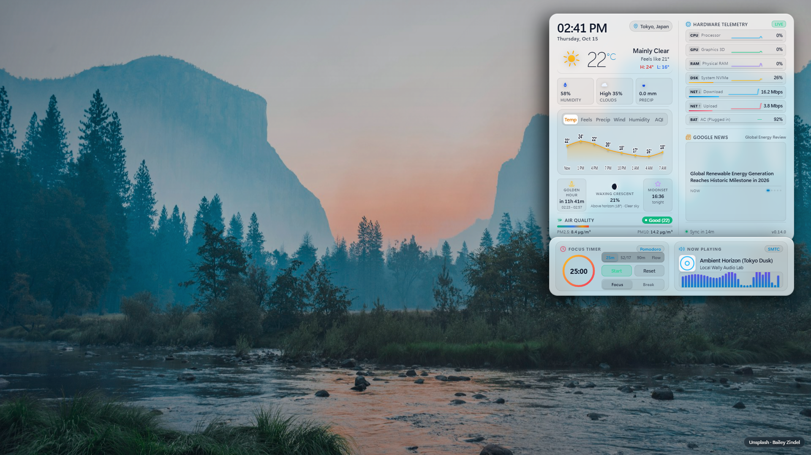

# Local Wally HUD

> **Hardware-optimized ambient weather wallpaper and desktop dashboard for Windows 11 and Lively Wallpaper.**

Local Wally HUD turns your Windows 11 desktop into a living ambient dashboard. It brings together live local weather, animated W3C SMIL metric icons, interactive 24-hour forecast curves, air quality indices, Windows media playback controls with a 60 FPS sound visualizer, a Pomodoro focus timer, PC hardware monitors, and regional news headlines. All components are presented against dynamic landscape photography that shifts lighting naturally throughout the day and night.

---

### Quick Actions
- 🚀 **[Download Latest Release](https://github.com/ravibaskaran/local-wally/releases/latest)**: Download the pre-packaged `local-wally.zip` for Lively Wallpaper.
- ⚡ **[Quick Install Guide](#quick-install-guide)**: Get running in under 60 seconds with zero configuration.
- 📖 **[Complete Setup & Controls Walkthrough](docs/walkthrough.md)**: Explore all provider settings, charts, and troubleshooting.
- 💬 **[Report a Bug or Request a Feature](https://github.com/ravibaskaran/local-wally/issues)**: Open an issue on GitHub.
- 🌐 **[Live Browser Preview](https://ravibaskaran.github.io/local-wally/)**: Test the interactive dashboard directly in your web browser.

---

  

---

## ✨ Why Local Wally?

Many video-based or unoptimized browser wallpapers introduce constant background CPU drain, reduce laptop battery runtimes, and risk frame drops during gaming.

**Local Wally was engineered differently:**
- **Zero API Keys Required Out of the Box**: Finds your local weather and solar times automatically without accounts, keys, or credit cards.
- **Engineered for Low Resource Overhead**: Target design of roughly 0.0% CPU and GPU load when parked or idle, measured informally on the author's test hardware (AMD Ryzen AI / Windows 11 / WebView2) with a 60 FPS animation loop when active. Real-world usage varies by hardware configuration, screen resolution, and active particle density.
- **Deep Sleep When Busy**: When you maximize a window, launch a game, or lock your screen, Lively Wallpaper pauses playback. Local Wally halts all animation loops, timers, and polling immediately.
- **Desktop-Friendly Layout**: Sits neatly on the right half of your screen so standard Windows desktop icons on the left stay unobstructed.
- **OneDrive Personal Settings Sync & Any-Folder Backup**: Syncs user settings and wallpaper preferences across PCs via direct browser OAuth or one-click CLI login with integrated Lively customization buttons, custom folder backup support, and a strict zero-location-data privacy firewall.
- **Wallpaper Favorites & "Less Like This" Engine**: Favorite wallpapers to a slide-out gallery or filter out unwanted scenes with a 6-second undo toast.
- **Truthful Weather Provenance & Next Update Schedule**: Live freshness badges (`Live · @ 9:25 AM`, `Cached`, `Stale`, `Fallback`) with exact observation times and dynamic next update countdowns (`Next: 9:40 AM`).
- **Relative Zero-Overlap Layout**: Responsive two-row weather card architecture eliminates badge and text collisions across all screen widths.

---

## 🔑 Keyless Defaults vs. Keyed Providers

Local Wally functions completely out of the box with zero API keys. Keys are only required if you choose to activate a commercial third-party provider:

| Telemetry Type | Default Provider (Zero Keys Needed) | Optional Keyed Providers (Key Required if Selected) |
|---|---|---|
| **Weather & Forecast** | **Open-Meteo**: High-precision global forecast models with zero configuration | **WeatherAPI.com** (free key), **OpenWeatherMap** (account key) |
| **Air Quality (AQI)** | **Open-Meteo AQI**: European AQI with PM2.5 and PM10 metrics | **WAQI / AQICN** (personal token) |
| **Wallpaper Photos** | **Unsplash**: High-resolution curated CDN photography matching weather and resolution | **Wallhaven**, **Pexels**, **Pixabay** (personal API keys) |
| **Regional News** | **Google News**: Keyless regional RSS headlines via CORS proxy | **NewsAPI**, **Currents News** (personal API keys) |
| **Music & Focus** | **Windows SMTC**: Local Windows media transport controls + 32-bar sound visualizer | None needed (100% local) |
| **Hardware Health** | **System Telemetry**: CPU, GPU, RAM, Disk, Net Down/Up, Battery | None needed (100% local) |

> [!NOTE]
> All credential fields in Lively Wallpaper are masked. If an optional keyed provider encounters an invalid key or network error, Local Wally falls back cleanly to its default keyless provider for that category (weather and air quality fall back to Open-Meteo, wallpapers fall back to Unsplash, and news falls back to Google News) to prevent broken states.

---

## ⚡ Quick Install Guide

### Method 1: Drag-and-Drop Install (Recommended)
1. Download **`local-wally.zip`** from the [Latest Release](https://github.com/ravibaskaran/local-wally/releases/latest).
2. Open **Lively Wallpaper** and drag `local-wally.zip` directly into the Lively window.
3. Click the newly added **Local Wally HUD** entry to activate it.

### Method 2: Browser Preview Mode
You can test Local Wally in any modern browser without installing Lively Wallpaper:
1. Clone this repository: `git clone https://github.com/ravibaskaran/local-wally.git`
2. Start the local preview server: `node serve.js`
3. Open `http://localhost:8080/` in Microsoft Edge, Google Chrome, or Brave.

### Upgrading an Existing Installation
Lively Wallpaper maintains customized properties per wallpaper identity. To upgrade your wallpaper without losing customized settings:
- Use the one-click updater script (`upgrade-local-wally.bat`), extract the new zip over your existing wallpaper folder, or use the built-in **Export / Import Settings** buttons.
- Read the step-by-step upgrade instructions in the [Walkthrough: Upgrading Local Wally](docs/walkthrough.md#7-upgrading-local-wally-while-preserving-settings).

---

## ⌨️ Verified Keyboard Shortcuts

When previewing in a browser or clicking the wallpaper on your desktop:

| Key | Action | Behavior |
|:---:|---|---|
| <kbd>D</kbd> | **Diagnostics & Location** | Opens the diagnostic overlay (FPS, GPU info, cache status) and city search tool. |
| <kbd>T</kbd> | **Toggle Temperature Unit** | Switches temperature display between Celsius (°C) and Fahrenheit (°F). |
| <kbd>C</kbd> | **Cycle Contrast Mode** | Cycles theme: Auto (Wallpaper-Adaptive) -> Dark Glass -> Light Glass. |
| <kbd>M</kbd> | **Cycle Demo Music** | Cycles demo audio tracks in preview mode (Synthwave -> Lo-Fi -> Ambient -> Idle). |
| <kbd>P</kbd> | **Pomodoro Start / Pause** | Starts or pauses the active Pomodoro focus countdown. |
| <kbd>←</kbd> / <kbd>→</kbd> | **Forecast Tabs** | Navigates between forecast metrics: Temp, Feels, Precip, Wind, Humidity, AQI. |
| <kbd>Click</kbd> / <kbd>Enter</kbd> | **Open Card Detail Drawer** | Slides open the detailed contextual telemetry drawer for any card. |
| <kbd>Esc</kbd> | **Dismiss Drawer or Popover** | Closes any open detail drawer, hover popover, or location search dropdown. |

*Note: Local Wally synchronizes weather and wallpaper data on its configured cadence (default 15 minutes). Regional news adheres to an independent quota firewall (15 minutes for keyed providers NewsAPI and Currents, 5 minutes for keyless Google News) to protect rate limits.*

---

## 🛡️ Get Help & Safe Support

If you run into an issue, check the troubleshooting table below or submit an issue on GitHub:

- 💬 **Open an Issue**: [Submit a Bug Report or Feature Request](https://github.com/ravibaskaran/local-wally/issues)

> [!WARNING]
> **Privacy Reminder**: Never submit API keys, unredacted settings exports (`.json`), personal street addresses, GPS home coordinates, or account credentials in public GitHub issues.

### Quick Troubleshooting Summary

| Problem | Likely Cause | Recommended Action |
|---|---|---|
| **Stuck on "Locating..."** | WebView2 host permission query timed out | Update to the latest release (which incorporates an automatic 1500 ms IP fallback race) or press <kbd>D</kbd> to enter a manual city. |
| **Wrong city detected** | IP geolocation resolved your ISP gateway city | Press <kbd>D</kbd> on your desktop, enter your desired city name or coordinates, and select it. |
| **Weather or AQI shows "--"** | Network connectivity issue or provider error | Check network access. Local Wally will retry automatically on the next 15-minute refresh cycle. |
| **WeatherAPI / OpenWeatherMap fails** | Key missing, invalid, or expired | Check your API key in Lively Settings. Local Wally automatically falls back to Open-Meteo. |
| **News headlines not updating** | News rate limit quota firewall is active | News providers enforce a rate-limit window (15 minutes for keyed providers, 5 minutes for Google News). Wait for the window to elapse. |
| **Clock frozen after PC sleep** | System resumed from S0 Modern Standby | Update to the latest release. The clock resynchronizes immediately upon wake and reconnect. |
| **Visualizer runs during games** | Lively Wallpaper window pause setting disabled | Verify that Lively Wallpaper is configured to pause when fullscreen applications are running. |

*For complete troubleshooting details, see [Section 10 of the Walkthrough](docs/walkthrough.md#10-troubleshooting-and-symptom-to-action-guide).*

---

## 💻 System Requirements

- **Operating System**: Windows 10 (Build 19041+) or Windows 11 (64-bit).
- **Wallpaper Host**: [Lively Wallpaper](https://rocksdanister.github.io/lively/) v2.0 or newer.
- **Runtime**: Microsoft Edge WebView2 (pre-installed on Windows 11).
- **Hardware**: Integrated graphics (Intel Iris Xe / Arc, AMD Radeon) or dedicated GPUs (NVIDIA GeForce, AMD Radeon RX).
- **Memory Footprint**: Typically under 60-90 MB resident memory for the wallpaper renderer on standard 1080p-1440p displays; total memory depends on screen resolution, device pixel ratio, and host WebView2 runtime state.

---

## 📜 Documentation & Changelog

- 📖 **[Detailed Setup & Walkthrough](docs/walkthrough.md)**: Full guide to all settings, providers, and advanced `config.js` options.
- 📄 **[Release Notes & Changelog](CHANGELOG.md)**: Full chronological release history and technical audit logs.
- 📦 **[GitHub Releases](https://github.com/ravibaskaran/local-wally/releases)**: Downloadable `.zip` packages and release assets.

---

## 📄 License

Local Wally HUD is open-source software licensed under the [MIT License](LICENSE).

Copyright (c) 2026 [Ravi Baskaran](https://github.com/ravibaskaran).
