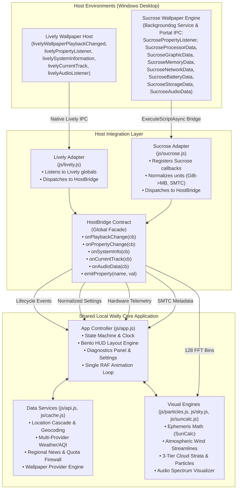

# Local Wally Sucrose Port Technical Design
**Target Host Integration: Lively Wallpaper & Sucrose Wallpaper Engine**
**Author:** Principal Software Architect
**Date:** 2026-10-16
**Baseline Version:** Local Wally HUD v0.15.0
**Target Sucrose Release:** v26.7.5.0 (Stable) / v26.10.5.0 (Pre-release)

---

## 1. Executive Recommendation and Decision Summary

### 1.1 Architectural Recommendation
Local Wally should be ported to **Sucrose Wallpaper Engine** using a **strictly unified dual-host architecture**. The application source code (HTML, CSS, core data pipelines, rendering engines, and visual presentation) will remain 100% shared between both hosts. Separate, isolated host integration layers will translate host-specific callbacks and schemas into a unified, host-agnostic bridge contract.

The build and release system will produce two discrete, self-contained distribution packages from the single repository:
1. `local-wally-lively.zip` — contains Lively-specific manifests (`LivelyInfo.json`, `LivelyProperties.json`) and the shared runtime.
2. `local-wally-sucrose.zip` — contains Sucrose-specific manifests (`SucroseInfo.json`, `SucroseProperties.json`, `SucroseCompatible.json`), Sucrose-compatible previews, and the shared runtime.

No codebase fork, native helper executables, background services, or external binaries are required or permitted. All capabilities can be fulfilled through standard Web APIs and Sucrose’s native Web Wallpaper IPC.

### 1.2 Decision Summary Matrix

| Architectural Domain | Selected Strategy | Rationale & Evidence | Status |
|---|---|---|---|
| **Codebase Topology** | Single shared codebase with dual host adapters | Eliminates UI drift and business-logic divergence. All math, rendering, and API logic remain unified in `js/app.js`, `js/api.js`, `js/particles.js`, `js/sky.js`. | **Verified** |
| **Host Bridge Boundary** | Facade abstraction (`HostBridge` aliased to `LivelyBridge`) | `app.js` already consumes host events via a clean 5-hook facade (`onPlaybackChange`, `onPropertyChange`, `onSystemInfo`, `onCurrentTrack`, `onAudioData`). Introducing `js/sucrose.js` to feed this existing boundary requires zero invasive refactoring in `app.js`. | **Verified** |
| **Runtime Target Engine** | Microsoft Edge WebView2 (`Type: 2` Web Wallpaper) | Sucrose documentation confirms WebView2 is the evergreen, modern engine using `file:///` local URI loading with `--allow-file-access-from-files` and full hardware acceleration. CefSharp introduces dynamic loopback port churn (`WatsonWebServer`). | **Verified** |
| **Disk (DSK) Telemetry** | System Drive (C:) Used Space % (Option B: Drive Capacity) | Sucrose `SystemStorage` reports logical/physical drive volumes (`LogicalDrivers`, `PhysicalDrivers`) but does **not** expose disk active time. As approved by maintainer decision, Local Wally under Sucrose adapts the DSK ring/metric to calculate System Drive (C:) used capacity (`(TotalSize - TotalFreeSpace) / TotalSize * 100`). The HUD label dynamically reflects `'DISK (C:)'` and hover popover displays used/total GB, providing an honest, active metric rather than a dead indicator. | **Verified** |
| **GPU Telemetry** | Map overall GPU load (`Graphic.Now`), relabel from "3D" to "GPU" | Sucrose `Graphic.Now` measures overall GPU engine utilization, unlike Lively's isolated Direct3D 3D engine counter (`CurrentGpu3D`). The adapter maps `obj.Now` to `CurrentGpu3D` and updates the label dynamically. | **Verified** |
| **Persistence & Cache** | WebView2 `file:///` persistence + property authority | In Sucrose WebView2, `file:///` maintains a stable origin backed by `%AppData%\Sucrose\Cache\WebView2`. Settings remain authoritative in `SucroseProperties.json`; `localStorage` remains an accelerator. | **Verified** |
| **Geolocation** | Existing silent GPS probe with 1500ms timeout + IP fallback | Local Wally v0.13.1 already contains a defensive timeout against WebView2 permission stalls, falling back to a 5-tier IP geolocation cascade. Manual location via `customLocation` property remains first priority. | **Verified** |
| **Audio Spectrum** | Direct feed into 32-band visualizer (128 normalized float bins) | Sucrose `SystemAudio.Data` provides exactly 128 normalized floats `[0.0, 1.0]` across a logarithmic 20 Hz – 16 kHz scale, matching Lively's `livelyAudioListener` shape exactly. | **Verified** |
| **Media Identity (SMTC)** | Unified SMTC track translation from `SystemAudio` | Sucrose bundles now-playing metadata (`Title`, `Artist`, `AlbumTitle`, `ThumbnailString`, `SourceAppId`) directly inside the `SystemAudio` payload, eliminating the separate `livelyCurrentTrack` IPC. | **Verified** |
| **Lifecycle Parking** | `document.visibilitychange` + timer epoch rebasing | Page Visibility API detects desktop occlusion; wall-clock rebasing prevents timer cascades when waking from Win32 process suspension under Sucrose's "Heavy" pause mode. | **Verified** |
| **Release Tooling** | Two-phase isolated staging in `scratch/package_release.js` | Generates `local-wally-lively.zip` and `local-wally-sucrose.zip` in dedicated staging directories with strict host-file exclusion lists and automated ZIP schema validation. | **Verified** |

---

## 2. Verified Current Local Wally Feature Inventory

The feature baseline was verified through direct inspection of the live repository files (`js/app.js`, `js/api.js`, `js/cache.js`, `js/lively.js`, `js/particles.js`, `js/sky.js`, `js/suncalc.js`, `config.js`, `LivelyProperties.json`, `LivelyInfo.json`, and `index.html`) against `DESIGN_BLUEPRINT.md` (v0.1.0 through v0.15.0).

```
Local Wally HUD v0.15.0 — Verified Subsystem Inventory
├── 1. Host Interface Layer (js/lively.js)
│   ├── Host playback state & visibility lifecycle (livelyWallpaperPlaybackChanged, document.visibilitychange)
│   ├── Dynamic property listener (livelyPropertyListener)
│   ├── Hardware telemetry pipeline (livelySystemInformation)
│   ├── SMTC media metadata pipeline (livelyCurrentTrack)
│   └── Audio spectrum pipeline (livelyAudioListener, 128 float bins)
├── 2. Core Application & HUD View (js/app.js, index.html, css/style.css)
│   ├── Unified #hud-stack container (580px fixed width, 14px flex gap)
│   ├── 9-position spatial layout grid (top-right, top-left, middle-*, bottom-*, center)
│   ├── Responsive single-column auto-collapse (<1100px width or <750px height)
│   ├── Bounding-box luminance sampling & adaptive glassmorphism contrast theme (auto/dark/light)
│   ├── Specular rim lighting, acrylic blur (0-40px slider), CSS custom properties
│   ├── Double-buffered background cross-fade (#bg-a, #bg-b, 1.2s cubic-bezier)
│   ├── Background wallpaper photo attribution watermark
│   ├── Contextual hover popover (#hud-hover-popover) & telemetry drawer (#hud-card-detail)
│   ├── In-HUD diagnostic panel ('D' key shortcut) with manual location search & autocomplete
│   └── Settings backup & restore (JSON export/import with API-key masking)
├── 3. Environmental & Telemetry Presentation (js/app.js)
│   ├── Temperature, condition summary, feels-like, high/low range
│   ├── Environmental metrics row: Humidity, Cloud cover, Rain outlook (animated Meteocons)
│   ├── Air Quality Index (AQI) badge & severity tier categorization
│   ├── Solar & Lunar Ephemeris: Day/night dynamic 3-card layout, solar vectors, twilight phases
│   ├── Offline moon phase calculation (SunCalc), SVG moon phase icons, cultural full moon badges
│   ├── Hardware monitor cards: CPU, GPU, RAM, DSK, NET-DOWN, NET-UP, BAT
│   ├── Text-track Unicode sparklines (8-sample history) & hardware load bar indicators
│   └── Battery status pill (percentage, charging state, power-saver mode)
├── 4. Data Services & Normalization Pipelines (js/api.js, js/cache.js)
│   ├── Geolocation cascade: Manual property -> GPS probe (1500ms timeout) -> IP cascade -> fallback
│   ├── Multi-provider weather: Open-Meteo (keyless), WeatherAPI.com (keyed), OpenWeatherMap (keyed)
│   ├── Multi-provider AQI: Open-Meteo AQI (keyless), WAQI / AQICN (token-supported)
│   ├── 24-hour weather/AQI forecast normalizer & 8-sample SVG forecast chart (Catmull-Rom splines)
│   ├── Multi-source wallpaper: Unsplash, Wallhaven, Pexels, Pixabay, Rotate (weather-context matching)
│   ├── Wallpaper recent-item history buffer (prevents immediate wallpaper repetition)
│   ├── Regional news cascade: 5-proxy CORS cascade for Google News RSS, NewsAPI, Currents, Rotate
│   ├── Regional news quota firewall & country tier memory cache
│   └── Client-side caching firewall (CacheManager, 5-30 min TTL, in-memory authority + localStorage)
├── 5. Visual Engines & Canvas Layers (js/particles.js, js/sky.js, js/suncalc.js)
│   ├── Dynamic celestial sky gradient & celestial Sun/Moon positioning (#sky-backdrop)
│   ├── Dynamic procedural solar lighting overlay (#solar-lighting-overlay)
│   ├── Weather-adaptive hero ceiling canvas (#hud-wind-canvas)
│   ├── Atmospheric wind streamline engine (WindStreamlineEngine)
│   ├── 3-tier synthetic cloud strata (low, mid, high layers)
│   ├── Background particle engine (ParticleEngine, rain, snow, stars, ambient dust)
│   └── Zero-allocation Struct-of-Arrays (SoA) TypedArray coordinate buffers
└── 6. Media Player & Focus Timer Companion Dock (js/app.js)
    ├── Windows SMTC media card (title, artist, album art thumbnail)
    ├── SMTC audio presence detection & hysteresis thresholding
    ├── 60 FPS real-time audio visualizer (32 frequency bars derived from 128 FFT bins)
    ├── Music quick-launch dock with desktop URI scheme handlers (Spotify, Apple Music, etc.)
    ├── Productivity focus timer suite (Pomodoro 25/5, 52/17 Rule, Ultradian 90/20, Flowtime)
    └── Concentric scalable SVG Pomodoro ring with linear progress gradients
```

---

## 3. Feature Parity Matrix

Every feature is classified into one of five rigorous architectural statuses:
1. **Shared Unchanged**: Runs in both hosts using identical code with zero modification.
2. **Adapter-Backed**: Backed by a host-specific translation adapter that normalizes data into the shared bridge contract.
3. **Host-Setting / Package Change**: Requires host-specific manifest or properties configuration schema.
4. **Degraded with Explicit Fallback**: Functional with a transparent, honest fallback where the host lacks underlying capability.
5. **Blocked Pending Host Support**: Feature cannot function due to missing host capability; documented for upstream resolution.

| Subsystem / Feature | Current Lively Implementation | Proposed Sucrose Implementation | Parity Status | Evidence & Architectural Notes |
|---|---|---|---|---|
| **Weather Telemetry** | Open-Meteo, WeatherAPI, OpenWeatherMap via `ApiService` | Identical `ApiService` fetch, normalization, and caching | **Shared Unchanged** | Pure browser JavaScript fetch pipeline; no host dependency. |
| **AQI Telemetry** | Open-Meteo AQI, WAQI via `ApiService` | Identical `ApiService` fetch and normalization | **Shared Unchanged** | Host-independent REST/JSON pipeline. |
| **Forecast Chart** | Catmull-Rom SVG spline HUD chart (`js/app.js`) | Identical SVG chart engine | **Shared Unchanged** | DOM/SVG rendering; no host dependency. |
| **Wallpaper Engine** | Unsplash, Wallhaven, Pexels, Pixabay, Rotate | Identical image search and cross-fade pipeline | **Shared Unchanged** | Pure Web image loading; double-buffered `#bg-a`/`#bg-b`. |
| **Regional News Feed** | Google News RSS (5-proxy cascade), NewsAPI, Currents | Identical 5-proxy cascade and XML DOMParser | **Shared Unchanged** | Pure Web fetch; protected by existing 15-minute quota firewall. |
| **Astronomical Sky** | SunCalc ephemeris, solar/lunar position, twilight | Identical SunCalc mathematical engine | **Shared Unchanged** | Offline astronomical ephemeris algorithms. |
| **Weather Effects** | `WindStreamlineEngine`, `ParticleEngine`, cloud strata | Identical HTML5 Canvas 2D engines | **Shared Unchanged** | Zero-allocation canvas rendering loops. |
| **Meteocons Icons** | SMIL animated SVG vectors (`assets/icons/weather/`) | Identical local SVG vector assets | **Shared Unchanged** | Compositor-driven SMIL SVG animations. |
| **HUD Bento Layout** | Flexbox `#hud-stack`, acrylic blur, 9 positions | Identical CSS styling and responsive layout | **Shared Unchanged** | CSS custom properties, backdrop-filter, flex containment. |
| **Diagnostics Panel** | Keyboard `D` toggle, location search, system info | Identical in-HUD DOM overlay | **Shared Unchanged** | Managed inside wallpaper DOM. |
| **Manual Geolocation** | `customLocation` in properties + diagnostic UI | `customLocation` textbox in `SucroseProperties.json` | **Host-Setting / Package Change** | Added to `SucroseProperties.json` schema. |
| **Automatic Geolocation** | GPS probe (1500ms timeout) -> IP cascade | Identical GPS probe -> IP cascade | **Shared Unchanged** | Defensive timeout prevents WebView2 permission deadlock. |
| **CPU Telemetry** | `data.CurrentCpu`, `data.NameCpu` from Lively IPC | `SucroseProcessorData`: `obj.Now`, `obj.Name` | **Adapter-Backed** | Normalized by `js/sucrose.js` into standard hardware payload. |
| **GPU Telemetry** | `data.CurrentGpu3D`, `data.NameGpu` from Lively IPC | `SucroseGraphicData`: `obj.Now`, `obj.Name` | **Adapter-Backed** | Normalized; metric represents overall GPU load. |
| **RAM Telemetry** | `data.TotalRam`, `data.CurrentRamAvail` (MB) | `SucroseMemoryData`: `obj.MemoryUsed`, `Available` (GiB) | **Adapter-Backed** | Scaled from GiB to MB in `js/sucrose.js` adapter. |
| **Network Bandwidth** | `data.CurrentNetDown`, `CurrentNetUp` (bytes/s) | `SucroseNetworkData`: `obj.Download`, `Upload` (bytes/s) | **Adapter-Backed** | Direct 1:1 unit match; converted to kbps display. |
| **Battery Telemetry** | `data.BatteryPercent`, `data.BatteryStatus` | `SucroseBatteryData`: `obj.LifePercent`, `PowerLineStatus` | **Adapter-Backed** | Normalized into standard battery state. |
| **Disk (DSK) Metric** | `data.CurrentDisk` (Disk active time %) | `SucroseStorageData`: `obj.LogicalDrivers` primary drive capacity | **Adapter-Backed** | Computes System Drive (C:) used capacity: `Math.round(((TotalSize - TotalFreeSpace) / TotalSize) * 100)`. Relabels card to `'DISK (C:)'` and details used/total GB. |
| **Audio Spectrum** | `livelyAudioListener` (128 normalized float bins) | `SucroseAudioData`: `obj.Data` (128 normalized float bins) | **Adapter-Backed** | Direct array pass-through into 32-band visualizer. |
| **SMTC Track Metadata** | `livelyCurrentTrack` (JSON metadata payload) | `SucroseAudioData`: `Title`, `Artist`, `ThumbnailString` | **Adapter-Backed** | Sourced from `SystemAudio` payload in `js/sucrose.js`. |
| **Audio Presence** | RMS amplitude tracking in `js/app.js` | Identical RMS calculation on `obj.Data` | **Shared Unchanged** | Pure mathematical evaluation on audio buffer. |
| **Music Quick Launch** | Desktop URI scheme anchors (`spotify:`, etc.) | Identical URI anchors + web fallbacks | **Shared Unchanged** | Standard Windows shell protocol activation in WebView2. |
| **Focus Timer Suite** | Pomodoro, 52/17, Ultradian, Flowtime (`js/app.js`) | Identical timer engine & concentric SVG ring | **Shared Unchanged** | Pure JavaScript timer state machine. |
| **Settings Customization** | `LivelyProperties.json` + `livelyPropertyListener` | `SucroseProperties.json` + `SucrosePropertyListener` | **Host-Setting / Package Change** | Separate property schema definitions; unified apply handler. |
| **Settings Backup/Restore** | Customize panel buttons + in-HUD JSON picker | In-HUD JSON picker primary; Portal buttons adapter-linked | **Adapter-Backed** | Desktop HUD file picker ensures focus and visibility. |
| **Process / Playback Parking**| `livelyWallpaperPlaybackChanged` IPC | `document.visibilitychange` + timer epoch rebasing | **Adapter-Backed** | Relies on Page Visibility API and host thread suspension. |
| **Multi-Monitor Handling** | Lively Display Modes (Duplicate / Span / Per-Screen) | Sucrose Display Modes (Primary / Expand) | **Shared Unchanged** | Sucrose Web wallpaper runs as a single instance. |

---

## 4. Proposed Module Boundaries and Host Callback/Data Flow

### 4.1 Topology Diagram



### 4.2 Module Contracts and Integration Boundaries

#### 1. Shared Modules (Zero Modifications Allowed)
- `js/suncalc.js`: Astronomical solar/lunar position engine. Pure mathematical library.
- `js/cache.js`: Client-side caching firewall (`CacheManager`). Encapsulates TTL, in-memory authority, and best-effort web storage persistence.
- `js/api.js`: All network communication, provider normalization (Open-Meteo, WeatherAPI, OWM, WAQI, Unsplash, Wallhaven, Pexels, Pixabay, Google News, NewsAPI, Currents), geolocation cascade, and quota firewalls.
- `js/particles.js`: Canvas particle rendering (`ParticleEngine`, `WindStreamlineEngine`).
- `js/sky.js`: Celestial gradient and Sun/Moon positioning engine.
- `css/style.css`: All styling, CSS custom properties, grid layouts, animations, and high-DPI scaling.
- `assets/**/*`: All SVG icons, Meteocons animations, and static artwork.

#### 2. The Host Adapter Boundary (`js/lively.js` and `js/sucrose.js`)
To maintain strict backward compatibility with existing Lively installations and test suites, the host adapter boundary preserves the public interface of `LivelyBridge`, exposing:
```javascript
HostBridge = {
  isPaused: boolean,
  properties: Object,
  getConfig(): Object,
  onPlaybackChange(callback: (isPaused: boolean) => void): void,
  onPropertyChange(callback: (name: string, value: any) => void): void,
  onSystemInfo(callback: (hwData: Object) => void): void,
  onCurrentTrack(callback: (trackData: Object) => void): void,
  onAudioData(callback: (fftArray: Float32Array | Array<number>) => void): void,
  setPaused(paused: boolean): void,
  emitProperty(name: string, value: any): void,
  emitSystemInfo(hwData: Object): void,
  emitCurrentTrack(trackData: Object): void,
  emitAudioData(fftArray: Array<number>): void
}
```
`global.LivelyBridge` will be maintained as a direct reference to `HostBridge` so that `js/app.js` requires zero structural changes.

#### 3. Execution Sequence in `index.html`
Both host scripts are loaded in sequential order:
```html
<script src="js/suncalc.js"></script>
<script src="js/cache.js"></script>
<script src="js/api.js"></script>
<script src="js/particles.js"></script>
<script src="js/sky.js"></script>
<script src="js/lively.js"></script>
<script src="js/sucrose.js"></script>
<script src="js/app.js"></script>
```
- When loaded in **Lively**: `js/lively.js` binds the native Lively hooks (`window.livelyPropertyListener`, etc.). `js/sucrose.js` detects that Sucrose is absent (user-agent does not start with `"Sucrose"`, and no Sucrose hooks are invoked) and remains dormant.
- When loaded in **Sucrose**: `js/lively.js` initializes default listeners. `js/sucrose.js` detects the Sucrose runtime (via `navigator.userAgent.startsWith("Sucrose")` or Sucrose hook declarations), wires the global Sucrose callbacks (`window.SucrosePropertyListener`, `window.SucroseProcessorData`, etc.), and routes incoming data into `HostBridge`.

---

## 5. Sucrose Telemetry, Media, Audio, Settings, Lifecycle, and Input Mappings

### 5.1 System Hardware Telemetry Mapping (`SucroseCompatible.json`)

Sucrose delivers hardware metrics via the **Backgroundog** service over an IPC transport, executing JavaScript templates declared in `SucroseCompatible.json`. Every system payload includes a boolean `State` field indicating sensor validity for that polling tick.

```json
{
  "SystemProcessor": "SucroseProcessorData({0});",
  "SystemGraphic": "SucroseGraphicData({0});",
  "SystemMemory": "SucroseMemoryData({0});",
  "SystemNetwork": "SucroseNetworkData({0});",
  "SystemBattery": "SucroseBatteryData({0});",
  "SystemStorage": "SucroseStorageData({0});",
  "SystemAudio": "SucroseAudioData({0});"
}
```

#### Field-by-Field Translation Specification

| Host Source & Callback | Sucrose Payload Fields | Normalized Local Wally Bridge Field | Unit Conversion / Mapping Logic |
|---|---|---|---|
| **CPU Telemetry**<br>`SucroseProcessorData(obj)` | `obj.State` (bool)<br>`obj.Now` (double %)<br>`obj.Name` (string) | `CurrentCpu`: `Math.round(obj.Now)`<br>`NameCpu`: `obj.Name.trim()` | **Input:** % (0-100). **Output:** Integer (0-100). Guard: Ignore tick if `!obj.State`. |
| **GPU Telemetry**<br>`SucroseGraphicData(obj)` | `obj.State` (bool)<br>`obj.Now` (double %)<br>`obj.Name` (string) | `CurrentGpu3D`: `Math.round(obj.Now)`<br>`NameGpu`: `obj.Name.trim()` | **Input:** % (0-100). **Output:** Integer (0-100). Represents overall GPU load. |
| **RAM Telemetry**<br>`SucroseMemoryData(obj)` | `obj.State` (bool)<br>`obj.MemoryLoad` (double %)<br>`obj.MemoryUsed` (double GiB)<br>`obj.MemoryAvailable` (double GiB) | `TotalRam`: `(obj.MemoryUsed + obj.MemoryAvailable) * 1024`<br>`CurrentRam`: `obj.MemoryUsed * 1024`<br>`CurrentRamAvail`: `obj.MemoryAvailable * 1024` | **Input:** GiB. **Output:** MB (Local Wally expects megabytes to format GB strings). |
| **Network Telemetry**<br>`SucroseNetworkData(obj)` | `obj.State` (bool)<br>`obj.Download` (double B/s)<br>`obj.Upload` (double B/s)<br>`obj.Name` (string) | `CurrentNetDown`: `obj.Download`<br>`CurrentNetUp`: `obj.Upload`<br>`NameNetCard`: `obj.Name.trim()` | **Input:** Bytes/sec. **Output:** Bytes/sec. `app.js` multiplies by 8 / 1000 to derive kbps when `NameNetCard` is present. |
| **Battery Telemetry**<br>`SucroseBatteryData(obj)` | `obj.State` (bool)<br>`obj.LifePercent` (int %)<br>`obj.PowerLineStatus` (bool/int)<br>`obj.SavingMode` (bool) | `BatteryPercent`: `obj.LifePercent`<br>`BatteryStatus`: `obj.PowerLineStatus ? 'Charging' : (obj.SavingMode ? 'Battery Saver' : 'On Battery')`<br>`BatteryCharging`: `!!obj.PowerLineStatus` | **Input:** % (0-100), PowerLine boolean. Dispatches to `syncBatteryState()`. If `!obj.State` or `LifePercent == 255`, triggers desktop unavailable mode. |
| **Disk Telemetry**<br>`SucroseStorageData(obj)` | `obj.State` (bool)<br>`obj.LogicalDrivers` (Array)<br>`obj.PhysicalDrivers` (Array) | `CurrentDisk`: `driveUsedPercent`<br>`DiskUsage`: `driveUsedPercent`<br>`DiskName`: `primaryDrive.Name`<br>`DiskTotal`: `primaryDrive.TotalSize`<br>`DiskFree`: `primaryDrive.TotalFreeSpace` | **Input:** Logical drive volumes. **Output:** System Drive (C:) used capacity % and byte metrics. Finds drive matching `C:\` or first Fixed drive. Computes `usedPercent = Math.round(((drive.TotalSize - drive.TotalFreeSpace) / drive.TotalSize) * 100)`. Sets `CurrentDisk: null` only if `!obj.State` or empty array. HUD relabels to `'DISK (C:)'`. |

### 5.2 Audio Spectrum and SMTC Media Mapping

In Sucrose, the `SystemAudio` hook delivers **both** real-time FFT frequency spectrum data and Windows System Media Transport Controls (SMTC) metadata in a unified JSON payload.

#### Audio Spectrum Normalization
- **Sucrose Feed:** `obj.Data` is an array of 128 normalized float values clamped to `[0.0, 1.0]`, representing linear magnitudes across a logarithmic frequency span from 20 Hz to 16 kHz.
- **Stereo Feed:** `obj.DataLeft` and `obj.DataRight` provide discrete stereo channels.
- **Local Wally Consumer:** `mediaVisualizer.processAudioData(audioArray)` consumes 128 mono bins and downsamples them into 32 display bars using RMS bin aggregation.
- **Translation:** The adapter forwards `obj.Data` directly to `HostBridge.emitAudioData(obj.Data)` without copying or re-allocating arrays.

#### SMTC Metadata Normalization
- **Sucrose Feed:** `obj.Title`, `obj.Artist`, `obj.AlbumTitle`, `obj.ThumbnailString`, `obj.SourceAppId`, `obj.PlaybackState`.
- **Local Wally SMTC Consumer:** `mediaVisualizer.handleTrackUpdate(track)` expects:
```javascript
{
  title: string,
  artist: string,
  album: string,
  thumbnail: string | null,
  sourceAppId: string,
  isPlaying: boolean
}
```
- **Translation:**
```javascript
var trackPayload = {
  title: obj.Title || '',
  artist: obj.Artist || '',
  album: obj.AlbumTitle || '',
  thumbnail: (obj.ThumbnailString && obj.ThumbnailString.length > 0) ? obj.ThumbnailString : null,
  sourceAppId: obj.SourceAppId || '',
  isPlaying: (obj.PlaybackState === 'Playing' || obj.PlaybackState === 1)
};
HostBridge.emitCurrentTrack(trackPayload);
```

### 5.3 Settings Customization Mapping (`SucroseProperties.json`)

Sucrose custom properties are defined in `SucroseProperties.json` and delivered to JavaScript through the `PropertyListener` template:
`"PropertyListener": "SucrosePropertyListener('{0}', {1});"`

When a user modifies a setting in the Sucrose Portal, the engine invokes:
`window.SucrosePropertyListener(name, controlObj)`
where `controlObj` contains `{ value: any, valuetext?: string, min?: number, max?: number, step?: number }`.

#### Complete Property Mapping Catalog (34 Controls)

| Setting Key | Lively Type | Sucrose Type | Control Configuration in `SucroseProperties.json` | Mapping Logic |
|---|---|---|---|---|
| `customLocation` | textbox | textbox | `{"type": "textbox", "text": "Custom Location (blank = Auto)", "value": ""}` | `val.value` -> String |
| `hudPosition` | dropdown | dropdown | `{"type": "dropdown", "text": "HUD Position", "value": 0, "items": ["Top Right", "Top Left", "Bottom Right", "Bottom Left", "Middle Right", "Middle Left", "Middle Top", "Middle Bottom", "Center"]}` | `val.value` -> Integer Index |
| `glassBlur` | slider | slider | `{"type": "slider", "text": "Glass Blur (px)", "value": 14, "min": 0, "max": 40, "step": 2}` | `val.value` -> Number |
| `particleDensity`| slider | slider | `{"type": "slider", "text": "Particle Density Multiplier", "value": 1.0, "min": 0.2, "max": 2.0, "step": 0.1}` | `val.value` -> Number |
| `tempUnit` | dropdown | dropdown | `{"type": "dropdown", "text": "Temperature Unit", "value": 0, "items": ["Celsius (°C)", "Fahrenheit (°F)"]}` | `val.value` -> Integer Index |
| `refreshInterval`| slider | slider | `{"type": "slider", "text": "Data Refresh Interval (Minutes)", "value": 15, "min": 5, "max": 30, "step": 1}` | `val.value` -> Number |
| `wallpaperProvider`| dropdown| dropdown | `{"type": "dropdown", "text": "Wallpaper Provider", "value": 0, "items": ["Unsplash", "Wallhaven", "Pexels", "Pixabay", "Rotate configured sources"]}` | `val.value` -> Integer Index |
| `unsplashApiKey`| textbox | passwordbox | `{"type": "passwordbox", "text": "Unsplash Access Key (Optional)", "value": ""}` | `val.value` -> String |
| `wallhavenApiKey`| textbox| passwordbox | `{"type": "passwordbox", "text": "Wallhaven API Key (Optional)", "value": ""}` | `val.value` -> String |
| `pexelsApiKey` | textbox | passwordbox | `{"type": "passwordbox", "text": "Pexels API Key (Optional)", "value": ""}` | `val.value` -> String |
| `pixabayApiKey` | textbox | passwordbox | `{"type": "passwordbox", "text": "Pixabay API Key (Optional)", "value": ""}` | `val.value` -> String |
| `weatherSimulation`| dropdown| dropdown| `{"type": "dropdown", "text": "Simulate Weather (Debug)", "value": 0, "items": ["Live Weather (Auto)", "Clear Day", "Rain & Storm", "Snow", "Starry Night"]}` | `val.value` -> Integer Index |
| `contrastMode` | dropdown | dropdown | `{"type": "dropdown", "text": "Glass Contrast Theme", "value": 0, "items": ["Auto (Wallpaper-Adaptive)", "Dark Glass (White Text)", "Light Glass (Dark Text)"]}` | `val.value` -> Integer Index |
| `showMediaFocusDock`| checkbox| checkbox | `{"type": "checkbox", "text": "Show Media & Focus Dock", "value": true}` | `val.value` -> Boolean |
| `focusTimerMode` | dropdown | dropdown | `{"type": "dropdown", "text": "Focus Timer Mode", "value": 0, "items": ["Pomodoro (25/5)", "52/17 Rule", "Ultradian (90/20)", "Flowtime (Stopwatch)"]}` | `val.value` -> Integer Index |
| `pomodoroFocusMinutes`| slider | slider | `{"type": "slider", "text": "Pomodoro Focus Duration (Min)", "value": 25, "min": 5, "max": 60, "step": 1}` | `val.value` -> Number |
| `pomodoroBreakMinutes`| slider | slider | `{"type": "slider", "text": "Pomodoro Break Duration (Min)", "value": 5, "min": 1, "max": 15, "step": 1}` | `val.value` -> Number |
| `pomodoroLongBreakMinutes`| slider| slider | `{"type": "slider", "text": "Pomodoro Long Break Duration (Min)", "value": 15, "min": 5, "max": 30, "step": 1}` | `val.value` -> Number |
| `enableAudioVisualizer`| checkbox| checkbox| `{"type": "checkbox", "text": "Enable Audio Visualizer (60 FPS)", "value": true}` | `val.value` -> Boolean |
| `enableDynamicSolarLighting`| checkbox| checkbox| `{"type": "checkbox", "text": "Dynamic Solar Lighting & Shadows", "value": true}` | `val.value` -> Boolean |
| `showNewsFeed` | checkbox | checkbox | `{"type": "checkbox", "text": "Show Regional News Feed", "value": true}` | `val.value` -> Boolean |
| `newsProvider` | dropdown | dropdown | `{"type": "dropdown", "text": "News Provider", "value": 0, "items": ["Auto (API keys first)", "Google News", "NewsAPI", "Currents News", "Rotate configured sources"]}` | `val.value` -> Integer Index |
| `newsApiKey` | textbox | passwordbox | `{"type": "passwordbox", "text": "NewsAPI Key (Optional)", "value": ""}` | `val.value` -> String |
| `currentsApiKey`| textbox | passwordbox | `{"type": "passwordbox", "text": "Currents API Key (Optional)", "value": ""}` | `val.value` -> String |
| `showHardwareMonitor`| checkbox| checkbox| `{"type": "checkbox", "text": "Show Hardware Monitor (CPU/GPU/RAM/Disk)", "value": true}` | `val.value` -> Boolean |
| `showCelestial` | checkbox | checkbox | `{"type": "checkbox", "text": "Show Solar & Lunar Ephemeris", "value": true}` | `val.value` -> Boolean |
| `showAqi` | checkbox | checkbox | `{"type": "checkbox", "text": "Show Air Quality Index (AQI)", "value": true}` | `val.value` -> Boolean |
| `showEnvironmentalMetrics`| checkbox| checkbox| `{"type": "checkbox", "text": "Show Environmental Metrics", "value": true}` | `val.value` -> Boolean |
| `showPomodoro` | checkbox | checkbox | `{"type": "checkbox", "text": "Show Pomodoro Focus Timer", "value": true}` | `val.value` -> Boolean |
| `showMediaPlayer`| checkbox| checkbox | `{"type": "checkbox", "text": "Show Media Player & Visualizer", "value": true}` | `val.value` -> Boolean |
| `showNetworkUsage`| checkbox| checkbox| `{"type": "checkbox", "text": "Show Network Bandwidth", "value": true}` | `val.value` -> Boolean |
| `showBatteryInfo`| checkbox| checkbox | `{"type": "checkbox", "text": "Show Laptop Battery Telemetry", "value": true}` | `val.value` -> Boolean |
| `weatherProvider`| dropdown| dropdown | `{"type": "dropdown", "text": "Weather Telemetry Provider", "value": 0, "items": ["Open-Meteo (Keyless)", "WeatherAPI.com (Free Key)", "OpenWeatherMap (Key Optional)"]}` | `val.value` -> Integer Index |
| `weatherapiKey` | textbox | passwordbox | `{"type": "passwordbox", "text": "WeatherAPI.com API Key (Optional)", "value": ""}` | `val.value` -> String |
| `openweathermapApiKey`| textbox| passwordbox | `{"type": "passwordbox", "text": "OpenWeatherMap API Key (Optional)", "value": ""}` | `val.value` -> String |
| `aqiProvider` | dropdown | dropdown | `{"type": "dropdown", "text": "Air Quality Provider", "value": 0, "items": ["Open-Meteo AQI (Keyless)", "WAQI / AQICN (Token Optional)"]}` | `val.value` -> Integer Index |
| `waqiApiKey` | textbox | passwordbox | `{"type": "passwordbox", "text": "WAQI API Token (Optional)", "value": ""}` | `val.value` -> String |
| `showForecastChart`| checkbox| checkbox | `{"type": "checkbox", "text": "Show Forecast Chart", "value": true}` | `val.value` -> Boolean |
| `defaultForecastTab`| dropdown| dropdown | `{"type": "dropdown", "text": "Default Forecast Tab", "value": 0, "items": ["Temperature", "Feels Like", "Precipitation", "Wind", "Humidity", "AQI"]}` | `val.value` -> Integer Index |
| `settingsExport` | button | button | `{"type": "button", "text": "Local Wally — Backup & Restore", "value": "Export Settings (incl. API keys)"}` | Button Click Trigger |
| `settingsImport` | button | button | `{"type": "button", "text": "", "value": "Import Settings"}` | Button Click Trigger |
| `settingsHelp` | label | label | `{"type": "label", "text": "", "value": "Custom Location at top sets city manually (blank = auto). Press D over desktop for diagnostics."}` | Static Label |

### 5.4 Lifecycle, Suspension, and Parking Architecture

1. **Light Pause vs. Heavy Pause**:
   - In **Light Pause**, Sucrose suspends DirectComposition / DWM presentation. The Chromium engine remains running, but WebView2 throttles rendering.
   - In **Heavy Pause**, Sucrose executes Win32 `NtSuspendProcess` on the live engine and all child processes (`msedgewebview2.exe`). Page JavaScript is literally frozen at the OS thread level; CPU consumption drops to 0.00%.
2. **Page Visibility Interop**:
   - WebView2 fires standard HTML5 `visibilitychange` (`document.hidden = true`) when occluded or minimized.
   - `HostBridge` listens to `visibilitychange` to immediately cancel the single `requestAnimationFrame` owner loop and sleep auxiliary tickers (Pomodoro ticker, visualizer wake loop).
3. **Timer Epoch Rebasing**:
   - When waking from Heavy Pause suspension, elapsed wall-clock time jumps discontinuously.
   - The app must rebase interval timestamps (`this.lastAtmosphereFetch`, `this.lastNewsFetch`, Pomodoro remaining seconds) against `Date.now()`. It must **never** fire queued interval bursts to catch up.

---

## 6. Persistence, Cache, CORS, Geolocation, Privacy, and API Quota Analysis

### 6.1 Origin Stability & `localStorage` Persistence Analysis

#### The Architecture Dilemma
In Chromium, `localStorage` and `indexedDB` are strictly partitioned by origin (`scheme://host:port`).
- **Sucrose WebView Engine (`Sucrose.Live.WebView`)**: Loads wallpapers using the local file URI scheme: `file:///C:/Users/.../AppData/Roaming/Sucrose/Themes/<id>/index.html`. Under WebView2 with `--allow-file-access-from-files` and a stable user data folder (`%AppData%\Sucrose\Cache\WebView2`), `localStorage` is tied to the `file://` scheme and **persists across reboots and engine relaunches**.
- **Sucrose CefSharp Engine (`Sucrose.Live.CefSharp`)**: Utilizes `WatsonWebServer` to serve content over `http://localhost:{port}/`, where `{port}` is dynamically allocated from available loopback ports at boot time. **Under CefSharp, every restart changes the origin, resulting in a blank `localStorage` on each launch.**

#### Architectural Defense Strategy
1. **Target Engine Pinning**: Local Wally will target and require the **WebView Engine** (`Engine-WebView`), which uses `file:///` and avoids dynamic loopback port churn.
2. **Settings Authority**: User customization settings are **never stored solely in `localStorage`**. The host's `SucroseProperties.json` file is the immutable source of truth on disk. Sucrose reads this file and dispatches `SucrosePropertyListener` on wallpaper boot, guaranteeing that all user preferences (API keys, layout, units, modes) are fully restored regardless of browser storage state.
3. **Cache Graceful Recovery**: `CacheManager` (`js/cache.js`) already implements an in-memory-first architecture (`_ensureMemory`, `_persistenceOk`). If `localStorage` is blank or wiped:
   - The app falls back to a fresh network fetch on initial boot.
   - The quota firewall (`_newsQuota`) defaults to safe, fail-closed quotas.
   - Wallpaper rotation cursor initializes cleanly to index 0.

### 6.2 Network CORS and Data Provider Request Firewall

When served via `file:///` in WebView2, Sucrose launches Chromium with the following command-line flags:
- `--allow-file-access-from-files`
- `--disable-features=OutOfBlinkCors,IsolateOrigins`

#### Provider Compatibility Audit
1. **Open-Meteo & OpenWeatherMap**: Support open CORS (`Access-Control-Allow-Origin: *`). Requests succeed directly via `fetch()` without headers restriction.
2. **Unsplash, Wallhaven, Pexels, Pixabay**: REST APIs and image CDN endpoints support cross-origin requests. Images load into double-buffered `Image()` elements without taint collisions.
3. **Google News RSS Feed**: Google News RSS blocks direct browser `fetch()`. Local Wally routes requests through a cascade of five resilient CORS gateways (`api.allorigins.win`, `corsproxy.io`, `codetabs`, `cors-anywhere`, and direct). This cascade operates identically under Sucrose WebView2.
4. **Currents News & NewsAPI**: API endpoints allow client requests when provided with valid user-supplied keys.

### 6.3 Geolocation Privacy and Permissions

1. **WebView2 Host Boundary**: Unlike Lively (which forwards OS geolocation or lets WebView2 prompt), Sucrose does not document a native geolocation callback bridge.
2. **Silent Resolution Cascade**: Local Wally’s `_runLocationDetect` starts with a silent `navigator.permissions.query({ name: 'geolocation' })` racing against a strict 1500ms timeout (`permTimeoutMs`).
   - If permissions are not already granted, it **never** triggers an interactive prompt.
   - It seamlessly cascades to free, zero-key IP geolocation services: `https://ipapi.co/json/` -> `https://ipwho.is/` -> `https://freeipapi.com/api/json/`.
3. **Manual Override**: If the user desires exact coordinates without network IP resolution, entering a city or `lat, lon` into the `customLocation` property bypasses all network location discovery.

### 6.4 API Quota and Multi-Monitor Protection

1. **Display Mode Multi-Instance Analysis**:
   - In Sucrose, multi-monitor Web wallpapers are rendered as a **single instance**:
     - *Primary Display Mode*: Wallpaper runs on one monitor only.
     - *Expand Mode*: Wallpaper spans across all monitors on a unified virtual desktop canvas.
     - *Duplicate Mode*: Disabled in current Sucrose releases.
   - Therefore, unlike multi-process desktop apps, Sucrose **does not spawn duplicate Web wallpaper instances**.
2. **Quota Firewall Enforcement**:
   - Even if multiple instances were launched in future pre-releases, Local Wally’s `ApiService._newsQuota` enforces strict cooldowns (15 minutes for keyed news, 5 minutes for Google News RSS).
   - In-flight request deduplication (`this._activeRequests`) prevents duplicate concurrent fetches for weather, air quality, or wallpaper images.

---

## 7. Performance Model and Measurement Plan

### 7.1 Performance Budget and Allocation Targets

| Execution Metric | Target Budget | Measurement Method | Verification Threshold |
|---|---|---|---|
| **Render Loop Allocations** | **0.00 bytes / frame** | Chrome DevTools Allocation Profiler (record 60 frames during quiet playback) | Zero heap allocations in RAF callback (`frame` -> `render`) |
| **Active Animation CPU** | **< 1.0% Core CPU** | Windows Performance Monitor / Process Hacker on `msedgewebview2.exe` | 60 FPS particle & visualizer animation on integrated GPU (Intel Iris / AMD Radeon) |
| **Occluded / Paused CPU** | **0.00% Host CPU** | Windows Performance Monitor (`\Process(msedgewebview2)\% Processor Time`) | True zero CPU load when occluded (`document.hidden`) or in Heavy Pause |
| **Host Bridge Overhead** | **< 0.15 ms / tick** | `performance.measure()` around `Sucrose*Data` dispatch handlers | Backgroundog IPC payload parse and fan-out takes under 150 microseconds per tick |
| **Peak Heap Footprint** | **< 65 MB Private Bytes**| Chrome DevTools Memory Heap Snapshot / Edge Task Manager | Stable memory baseline; no progressive leak over 24-hour continuous burn-in |
| **Network Egress** | **<= 12 requests / hour** | Service request counter in `ApiService` (15-min weather + 15-min wallpaper + news) | Never exceeds 12 background requests per hour during steady-state operation |

### 7.2 Zero-Allocation Render Loop Guarantees
Local Wally maintains strict zero-allocation performance guarantees in its primary animation frame loop:
1. **TypedArray SoA Buffers**: Particle positions, velocities, and lifetimes are stored in pre-allocated `Float32Array` buffers (`particles.js`).
2. **Pre-Allocated Audio Buffers**: The 32 visualizer bar heights use reusable `Float32Array(32)` arrays. Frequency bin smoothing uses in-place exponential attenuation:
   `barHeights[i] = (barHeights[i] * 0.75) + (targetHeight * 0.25);`
3. **SMIL Hardware Compositing**: Meteocons animated icons use native W3C SMIL vectors offloaded entirely to the GPU compositor thread, consuming 0% main-thread JavaScript execution.
4. **Single RAF Owner**: Only one `requestAnimationFrame` loop exists in `app.js`. If the wallpaper is paused or no visualizer/particles are active, the RAF handle is cancelled via `cancelAnimationFrame()`.

### 7.3 Host Bridge Measurement Protocol
To measure host bridge overhead independently from Local Wally rendering:
1. Measure `ExecuteScriptAsync` string evaluation time in WebView2 using High-Resolution Time (`performance.now()`).
2. Track GC pressure: Run Chrome DevTools Timeline with JS Heap collection enabled. Verify that parsing the Backgroundog JSON payload in `SucroseAudioData` and `SucroseProcessorData` does not cause Gen-0 garbage collections at a rate higher than once every 60 seconds.

---

## 8. Release Packaging Design for Both Archives

The packaging process will be managed by an updated `scratch/package_release.js` script that builds two completely discrete, validated ZIP archives from clean, isolated staging directories.

```
Distribution Package Topologies
├── local-wally-lively.zip
│   ├── LivelyInfo.json              [Lively Manifest]
│   ├── LivelyProperties.json        [Lively Customization Schema]
│   ├── index.html                   [Shared HTML5 Shell]
│   ├── config.js                    [Shared Configuration]
│   ├── thumbnail.jpg                [Shared 16:9 Thumbnail]
│   ├── LICENSE                      [MIT License]
│   ├── css/
│   │   └── style.css                [Shared Stylesheet]
│   ├── js/
│   │   ├── suncalc.js               [Shared Ephemeris Engine]
│   │   ├── cache.js                 [Shared Caching Firewall]
│   │   ├── api.js                   [Shared Data Pipelines]
│   │   ├── particles.js             [Shared Particle/Atmospheric Canvas]
│   │   ├── sky.js                   [Shared Celestial Canvas]
│   │   ├── lively.js                [Lively Host Adapter]
│   │   ├── sucrose.js               [Sucrose Host Adapter - dormant in Lively]
│   │   └── app.js                   [Shared Main Application]
│   └── assets/                      [Shared Meteocons SVGs, Moon Icons]
│
└── local-wally-sucrose.zip
    ├── SucroseInfo.json             [Sucrose Manifest - Type 2 Web]
    ├── SucroseProperties.json       [Sucrose Customization Controls]
    ├── SucroseCompatible.json       [Sucrose Hook Templates]
    ├── index.html                   [Shared HTML5 Shell]
    ├── config.js                    [Shared Configuration]
    ├── thumbnail.jpg                [Shared 16:9 Thumbnail]
    ├── preview.gif                  [Animated Preview for Sucrose Portal]
    ├── LICENSE                      [MIT License]
    ├── css/
    │   └── style.css                [Shared Stylesheet]
    ├── js/
    │   ├── suncalc.js               [Shared Ephemeris Engine]
    │   ├── cache.js                 [Shared Caching Firewall]
    │   ├── api.js                   [Shared Data Pipelines]
    │   ├── particles.js             [Shared Particle/Atmospheric Canvas]
    │   ├── sky.js                   [Shared Celestial Canvas]
    │   ├── lively.js                [Lively Host Adapter - dormant in Sucrose]
    │   ├── sucrose.js               [Sucrose Host Adapter]
    │   └── app.js                   [Shared Main Application]
    └── assets/                      [Shared Meteocons SVGs, Moon Icons]
```

### 8.1 Package Manifest Specifications

#### 1. `LivelyInfo.json` (Preserved Exact Baseline)
```json
{
  "AppVersion": "2.0.0.0",
  "Title": "Local Wally HUD",
  "Thumbnail": "thumbnail.jpg",
  "Preview": "thumbnail.jpg",
  "Desc": "Hyper-optimized ambient weather wallpaper with celestial SunCalc ephemeris sky and Mac-style frosted glass HUD.",
  "Author": "Ravi Baskaran",
  "License": "MIT",
  "Contact": "https://github.com/ravibaskaran/local-wally",
  "Type": 1,
  "FileName": "index.html",
  "Arguments": "--system-information --system-nowplaying --audio --pause-event true"
}
```

#### 2. `SucroseInfo.json` (Sucrose Native Specification)
```json
{
  "AppVersion": "26.7.5.0",
  "Version": "0.15.0.0",
  "Title": "Local Wally HUD",
  "Thumbnail": "thumbnail.jpg",
  "Preview": "preview.gif",
  "Description": "Hyper-optimized ambient weather wallpaper with celestial SunCalc ephemeris sky and Mac-style frosted glass HUD.",
  "Author": "Ravi Baskaran",
  "License": "LICENSE",
  "Contact": "https://github.com/ravibaskaran/local-wally",
  "Type": 2,
  "Source": "index.html",
  "Tags": ["Weather", "Clock", "Telemetry", "HUD", "Ambient"],
  "Arguments": null,
  "Localization": null
}
```
*Note on AppVersion:* Set to `26.7.5.0` (matching the current stable Sucrose release line `yy.MM.dd.0`). Sucrose rejects packages with `AppVersion` greater than the running host version.

#### 3. `SucroseCompatible.json` (Hook Templates)
```json
{
  "SystemProcessor": "SucroseProcessorData({0});",
  "SystemGraphic": "SucroseGraphicData({0});",
  "SystemMemory": "SucroseMemoryData({0});",
  "SystemNetwork": "SucroseNetworkData({0});",
  "SystemBattery": "SucroseBatteryData({0});",
  "SystemStorage": "SucroseStorageData({0});",
  "SystemAudio": "SucroseAudioData({0});"
}
```

### 8.2 Isolated Staging & Failure-Safe Generation Workflow

The packaging script will execute an atomic staging pipeline:
1. **Clean Staging Roots**:
   - `dist_staging_lively/`
   - `dist_staging_sucrose/`
2. **Copy Shared Files**:
   - Copy `index.html`, `config.js`, `css/style.css`, `js/*.js`, `assets/`, `thumbnail.jpg`, `LICENSE` to both staging directories.
3. **Inject Host-Specific Metadata**:
   - Copy `LivelyInfo.json` and `LivelyProperties.json` into `dist_staging_lively/`.
   - Copy `SucroseInfo.json`, `SucroseProperties.json`, `SucroseCompatible.json`, and `preview.gif` into `dist_staging_sucrose/`.
4. **Strict Isolation Validation**:
   - Assert `dist_staging_lively/` does NOT contain `Sucrose*.*`.
   - Assert `dist_staging_sucrose/` does NOT contain `Lively*.*`.
   - Assert `SucroseInfo.json` has `Type === 2` (Web Wallpaper) and `Source === "index.html"`.
   - Assert `LivelyInfo.json` has `Type === 1` and `FileName === "index.html"`.
5. **Atomic Archiving**:
   - Compress `dist_staging_lively/` -> `local-wally-lively.tmp.zip` -> `local-wally-lively.zip`.
   - Compress `dist_staging_sucrose/` -> `local-wally-sucrose.tmp.zip` -> `local-wally-sucrose.zip`.
   - Use `.bak` atomic replacement; if compression or validation fails for either archive, roll back both archives atomically.
6. **Post-Build Validation**:
   - Read ZIP central directory records to ensure zero 0-byte files, valid entry points, and expected uncompressed footprints.

---

## 9. Risks, Assumptions, Unresolved Decisions, and Upstream Requests

### 9.1 Risk Analysis and Resolution Register

| Risk / Question | Direct Evidence & Finding | Technical Impact | Architectural Decision | Confidence | Confirmation Needed |
|---|---|---|---|---|---|
| **Disk Active-Time Telemetry** | Primary audit of Sucrose `Create-System-API` confirms `SystemStorage` provides drive volumes (`Drivers`, `LogicalDrivers`, `PhysicalDrivers`) but **zero disk active-time / utilization metrics**. | The DSK sparkline and bar in Local Wally cannot display real active-time I/O on Sucrose. | **Approved Decision (Option B):** Adapt DSK card to display System Drive (C:) used capacity percentage (`C: XX% Used`). Label dynamically reflects `'DISK (C:)'` and hover popover presents used vs total GiB (`C: 240/512 GB`). This maintains metric honesty (explicitly labeled as drive capacity, not I/O time) while providing a live, useful storage indicator. | **Verified** (100%) | **Resolved** (Option B approved by maintainer). |
| **GPU Load Semantics** | In Sucrose, `Graphic.Now` measures aggregate GPU load, whereas Lively's `CurrentGpu3D` measures isolated 3D engine load. | GPU metric on Sucrose will include video decode and 2D blits, resulting in slightly higher reported percentages. | **Decision:** Map `Graphic.Now` to GPU metric; update HUD label to dynamically show `NameGpu` or "GPU" rather than hardcoding "Graphics 3D". | **Verified** (95%) | None. Safe and technically accurate. |
| **Origin & Cache Persistence** | Sucrose WebView2 engine uses `file:///` URI scheme with fixed user data dir (`%AppData%\Sucrose\Cache\WebView2`), preserving `localStorage`. CefSharp uses dynamic port HTTP loopback (`WatsonWebServer`), wiping `localStorage` on restart. | If CefSharp is selected, web storage caches are wiped on reboot. | **Decision:** Target and document WebView2 as the required engine. Keep `SucroseProperties.json` as the immutable source of truth for all user preferences. | **Verified** (98%) | None. Solid architecture pattern. |
| **Silent Geolocation** | WebView2 can hang if permission prompts are unhandled by the host. | Without a timeout, GPS probe can stall wallpaper boot. | **Decision:** Retain Local Wally’s existing 1500ms `gpsProbe` timeout. If ungranted or hung, drop silently to IP geolocation cascade. | **Verified** (100%) | None. Already proven in production code. |
| **Process Suspension (Heavy Pause)** | In Heavy Pause mode, Sucrose suspends engine threads via `NtSuspendProcess`. | Wall-clock time jumps forward while suspended. Interval timers could fire in a burst upon resume. | **Decision:** Rebase all interval epochs against `Date.now()` upon waking. Cancel RAF loop when `document.hidden` is true. | **Verified** (95%) | None. Standard defensive practice. |
| **Masked Password Credentials** | `passwordbox` in `SucroseProperties.json` masks input in the Portal GUI, but saves plain text in `SucroseProperties.json` on disk. | User API keys are masked from shoulder-surfing, but are not encrypted in DPAPI or Windows Credential Manager. | **Decision:** Document clearly that `passwordbox` provides UI masking only, not OS-level cryptographic secret storage. | **Verified** (100%) | None. Transparent security disclosure. |
| **Display Modes & API Quotas** | Sucrose Web wallpaper executes as a single process (either on primary monitor or spanning displays in Expand mode). | No duplicate wallpaper instances are created across monitors. | **Decision:** Existing 15-minute quota firewall and in-flight request deduplication are fully sufficient. | **Verified** (95%) | None. Direct evidence from Sucrose wiki. |

### 9.2 Upstream Feature Requests for Taiizor/Sucrose
1. **Disk Activity Telemetry Counter**: Request that the Backgroundog service poll Windows PDH counter `\PhysicalDisk(_Total)\% Disk Time` and expose `Storage.Now` (or `Storage.ActiveTime`) alongside the volume collection.
2. **SMTC Progress & Seek Tracking**: Request that `SystemAudio` expose playback duration and current position in seconds for real-time scrubber support in Web wallpapers.

---

## 10. File-Level Implementation Plan

*Note: In accordance with the strict design task boundary, no files are modified or created during this design phase other than `SUCROSE_PORT_DESIGN.md`.*

The eventual implementation phase will touch only the following targeted files:

```
Proposed Implementation Change Footprint
├── 1. New Host Integration Files
│   ├── js/sucrose.js                  [NEW] Sucrose host adapter & callback listener
│   ├── SucroseInfo.json               [NEW] Sucrose package manifest (Type: 2)
│   ├── SucroseProperties.json         [NEW] Sucrose customization controls schema
│   ├── SucroseCompatible.json         [NEW] Sucrose Backgroundog hook templates
│   └── preview.gif                    [NEW] Animated package preview asset
├── 2. Minor Wiring in Existing Shared Files
│   ├── index.html                     [EDIT] Add <script src="js/sucrose.js"></script>
│   ├── js/lively.js                   [EDIT] Expose HostBridge alias; export cleanly
│   ├── js/app.js                      [EDIT] Dynamic GPU ('GPU') and Disk ('DISK (C:)') label formatting
│   └── scratch/package_release.js     [EDIT] Multi-target release packager & validator
├── 3. Documentation & Verification
│   ├── docs/SUCROSE_SETUP.md          [NEW] User guide for installing in Sucrose
│   ├── scratch/test_sucrose_bridge.js [NEW] Headless mock test suite for Sucrose callbacks
│   └── README.md                      [EDIT] Add Sucrose release download & usage instructions
```

### Detailed File Responsibilities

#### `js/sucrose.js` (New File)
- Implements `window.SucrosePropertyListener(name, val)`: translates property updates and passes them to `HostBridge.emitProperty(name, val.value)`.
- Implements `window.SucroseProcessorData(obj)`: extracts `obj.Now` and `obj.Name`, guards against `!obj.State`, and calls `HostBridge.emitSystemInfo`.
- Implements `window.SucroseGraphicData(obj)`: extracts `obj.Now` and `obj.Name`, guards against `!obj.State`.
- Implements `window.SucroseMemoryData(obj)`: converts `obj.MemoryUsed` and `obj.MemoryAvailable` from GiB to MB.
- Implements `window.SucroseNetworkData(obj)`: forwards `obj.Download` and `obj.Upload` bytes/sec.
- Implements `window.SucroseBatteryData(obj)`: translates `obj.LifePercent` and `obj.PowerLineStatus`.
- Implements `window.SucroseStorageData(obj)`: parses `obj.LogicalDrivers`, identifies the primary system drive (`C:\` or first Fixed drive), computes used capacity percentage `Math.round(((TotalSize - TotalFreeSpace) / TotalSize) * 100)`, and forwards `CurrentDisk`, `DiskName`, `DiskTotal`, and `DiskFree` to `HostBridge.emitSystemInfo`.
- Implements `window.SucroseAudioData(obj)`: forwards `obj.Data` (128 floats) to `HostBridge.emitAudioData` and SMTC metadata to `HostBridge.emitCurrentTrack`.

#### `index.html` (One-Line Update)
- Add `<script src="js/sucrose.js"></script>` immediately following `js/lively.js` and preceding `js/app.js`.

#### `scratch/package_release.js` (Packager Update)
- Add `dist_staging_lively` and `dist_staging_sucrose` isolated builders.
- Produce `local-wally-lively.zip` and `local-wally-sucrose.zip`.
- Validate package integrity and manifest compliance prior to completion.

---

## 11. Acceptance Criteria and Staged Verification Matrix

### 11.1 Acceptance Gates

| Stage | Milestone Gate | Verification Criteria | Pass / Fail Condition |
|---|---|---|---|
| **Gate 1** | **Packaging Isolation** | `scratch/package_release.js` produces `local-wally-lively.zip` and `local-wally-sucrose.zip`. | **PASS** when neither zip contains foreign host files, manifests validate, and uncompressed archives extract cleanly. |
| **Gate 2** | **Lively Zero-Regression** | Import `local-wally-lively.zip` into Lively Wallpaper v2.0+. | **PASS** when weather, news, wallpaper rotation, hardware HUD, SMTC, audio visualizer, and focus timer operate with zero regressions. |
| **Gate 3** | **Sucrose Import & Launch** | Import `local-wally-sucrose.zip` into Sucrose Wallpaper Engine v26.7.5.0+ via Portal. | **PASS** when wallpaper loads under WebView engine, renders at 60 FPS, and displays `#hud-stack`. |
| **Gate 4** | **Customization Parity** | Adjust settings in Sucrose Portal Customize panel (location, position, units, providers, API keys). | **PASS** when `SucrosePropertyListener` receives updates and changes reflect immediately in the HUD. |
| **Gate 5** | **Hardware Telemetry** | Inspect CPU, GPU, RAM, NET, BAT in HUD under Sucrose. | **PASS** when CPU, GPU, RAM, and NET update smoothly with valid readings; DSK displays System Drive (C:) used capacity percentage (`DISK (C:) XX%`) with hover drawer showing accurate used/total GiB. |
| **Gate 6** | **SMTC & Visualizer** | Play music in Spotify / Windows Media Player. | **PASS** when track title, artist, and album art appear on media card, and 32-band visualizer dances to 128-bin FFT stream. |
| **Gate 7** | **Lifecycle & Suspension** | Lock workstation (Win+L) or fullscreen a video game. | **PASS** when wallpaper rendering halts, RAF loop cancels, and CPU drops to 0.00% under Heavy Pause. |
| **Gate 8** | **Reboot Persistence** | Restart Sucrose Wallpaper Engine. | **PASS** when user preferences remain intact from `SucroseProperties.json`, weather refreshes from cache or silent API fetch, and no error popups appear. |

### 11.2 Headless Automated Mock Verification (`test_sucrose_bridge.js`)
Before physical desktop deployment, a headless Node.js test script will simulate the Sucrose runtime:
1. Initialize mock `window`, `document`, and `navigator` with `userAgent = "Sucrose/2.3 (Windows NT 10.0; Wallpaper Engine) SucroseWebKit"`.
2. Load `js/lively.js`, `js/sucrose.js`, and `js/app.js`.
3. Dispatch synthetic `SucrosePropertyListener` calls for all 34 properties; assert internal `HostBridge.properties` reflect correct values.
4. Dispatch synthetic `SucroseProcessorData`, `SucroseGraphicData`, `SucroseMemoryData`, `SucroseNetworkData`, `SucroseBatteryData`, and `SucroseStorageData` (mocking logical drive C:); assert `handleSystemInfo` formats strings correctly and sets DSK to drive capacity percentage (`DISK (C:)`).
5. Dispatch synthetic `SucroseAudioData` with 128 pseudo-random float bins and track metadata; assert `mediaVisualizer` and media card receive payload.
6. Trigger `document.visibilitychange` (`hidden = true`); assert `isPlaybackPaused === true` and RAF owner loop cancels.
7. Assert zero unhandled exceptions or NaN values.

---

## 12. Primary Documentation and Evidence Citations

All architectural claims, field names, units, and engine behaviors cited in this document were verified against live primary sources on **2026-10-16**:

- **Sucrose Releases & Versioning**: Stable `v26.7.5.0` (release format `yy.MM.dd.0`), Pre-release `v26.10.5.0`. [Taiizor/Sucrose Releases](https://github.com/Taiizor/Sucrose/releases).
- **Package Manifest Schema**: `SucroseInfo.json` specification, required fields, and `Type: 2` (Web Wallpaper) definition. [Create Package Format Wiki](https://github.com/Taiizor/Sucrose/wiki/Create-Package-Format).
- **Hook Template Declarations**: `SucroseCompatible.json` schema, `string.Format` templates, and Backgroundog IPC dispatch. [Create JS Bridge Wiki](https://github.com/Taiizor/Sucrose/wiki/Create-JS-Bridge).
- **System Telemetry Callbacks & Fields**: Complete specification of `SucroseProcessorData`, `SucroseGraphicData`, `SucroseMemoryData`, `SucroseNetworkData`, `SucroseBatteryData`, `SucroseStorageData`, and the `State` validity flag. [Create System API Wiki](https://github.com/Taiizor/Sucrose/wiki/Create-System-API).
- **Audio Spectrum & SMTC Metadata**: 128 normalized float bins `[0.0, 1.0]`, logarithmic 20 Hz – 16 kHz scale, and embedded SMTC metadata fields. [Create Audio API Wiki](https://github.com/Taiizor/Sucrose/wiki/Create-Audio-API).
- **Customization Controls & Properties**: `SucroseProperties.json` schema, control classes (`textbox`, `passwordbox`, `slider`, `dropdown`, `checkbox`, `button`, `label`), and `SucrosePropertyListener` live file watcher. [Create Customization Controls Wiki](https://github.com/Taiizor/Sucrose/wiki/Create-Customization-Controls).
- **Web Wallpaper Architecture & Serving**: Local HTTP vs. `file:///` loading, Backgroundog IPC transports (Pipe, Signal, Transmission), and `ExecuteScriptAsync` fan-out. [Create Web Architecture Wiki](https://github.com/Taiizor/Sucrose/wiki/Create-Web-Architecture).
- **WebView2 Engine Specifications**: Microsoft Edge WebView2 runtime dependency (`>= 131.0.2903.70`), `file:///` local URI scheme, and command-line arguments (`--allow-file-access-from-files`). [Engine-WebView Wiki](https://github.com/Taiizor/Sucrose/wiki/Engine-WebView).
- **Performance Rules & Process Suspension**: Light pause vs. Heavy pause (`NtSuspendProcess` process thread suspension) and condition triggers. [Performance Rules Wiki](https://github.com/Taiizor/Sucrose/wiki/Performance-Rules).
- **Multi-Monitor Display Architecture**: Single web instance execution in Primary and Expand modes; application type isolation. [Multi-Monitor Wiki](https://github.com/Taiizor/Sucrose/wiki/Multi-Monitor).
- **Local Wally Baseline Architecture**: Verified directly from `DESIGN_BLUEPRINT.md` (v0.1.0 – v0.15.0), `LivelyProperties.json`, `LivelyInfo.json`, `config.js`, `js/app.js`, `js/api.js`, `js/cache.js`, and `js/lively.js`.
